
Министерство образования Республики Беларусь

Учреждение образования

“Брестский Государственный технический университет”

Кафедра ИИТ

       

Лабораторная работа №4

По дисциплине “Криптографические методы защиты информации”

Тема: “PKI, HTTPS и TLS 1.3. Развертывание тестового Удостоверяющего Центра (CA), выпуск сертификатов X.509, настройка HTTPS-сервера и анализ рукопожатия TLS 1.3 в Wireshark”

Вариант: 6

     

Выполнил:

Студент 3 курса

Группы ИИ-27

Гурин М.Д.

Проверил:

Хацкевич А.С.

     

Брест 2026

---

# Цель
    на собственном тестовом CA выпустить цепочку сертификатов X.509 с расширениями, настроить HTTPS-сервер, принимающий только TLS 1.3, проверить цепочку доверия и отзыв, захватить рукопожатие TLS 1.3 и разобрать его в Wireshark, в том числе после расшифровки через журнал ключей (SSLKEYLOGFILE).

# Вариант 6

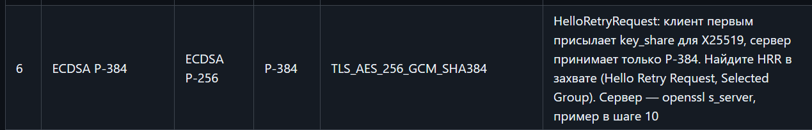

# Ход работы

Итак, сначала я установил WSL2, а затем на него установил Ubuntu и вся лабораторная работа будет производится в оболочке powershell. Поставил себе имя пользователя как matuy 

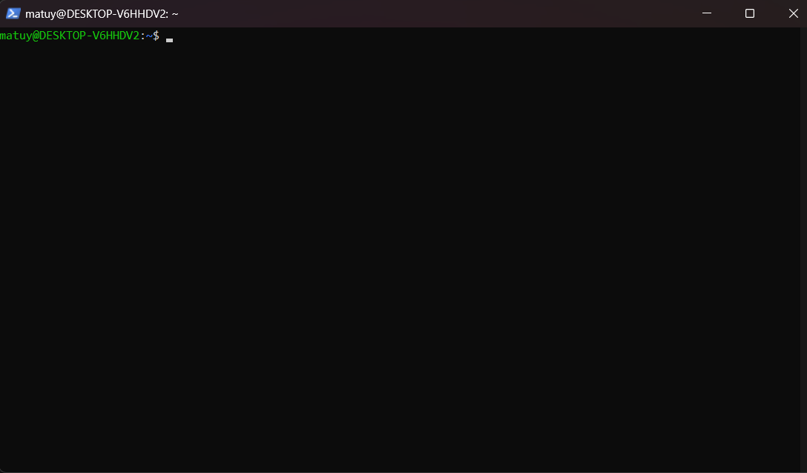

затем создаю в ней директорию lab4 командой mkdir lab4 и затем cd lab4 перехожу в саму директорию

## 1. Корневой CA

Позже в ней ввожу команды (в моем варианте используется эллиптический кривые с размером ключа в 384)

    cd ~/lab4
    openssl genpkey -algorithm EC -pkeyopt ec_paramgen_curve:P-384  -out root/root.key
    chmod 600 root/root.key
    openssl req -new -x509 -key root/root.key -sha384 -days 3650 -subj '/C=BY/O=Lab PKI/CN=Lab Root CA' -addext 'basicConstraints=critical,CA:TRUE,pathlen:1' -addext 'keyUsage=critical,keyCertSign,cRLSign' -addext 'subjectKeyIdentifier=hash' -out root/root.crt

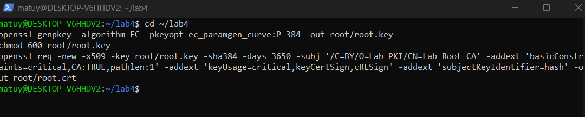

## 2. Промежуточный CA 

    cat > inter/inter.ext <<'EOF'
    basicConstraints=critical,CA:TRUE,pathlen:0
    keyUsage=critical,keyCertSign,cRLSign
    subjectKeyIdentifier=hash
    authorityKeyIdentifier=keyid:always
    EOF

    openssl genpkey -algorithm EC -pkeyopt ec_paramgen_curve:P-256 -out inter/inter.key && chmod 600 inter/inter.key
    openssl req -new -key inter/inter.key -subj '/C=BY/O=Lab PKI/CN=Lab Intermediate CA' -out inter/inter.csr
    openssl x509 -req -in inter/inter.csr -CA root/root.crt -CAkey root/root.key -CAcreateserial -sha384 -days 1825 -extfile inter/inter.ext -out inter/inter.crt

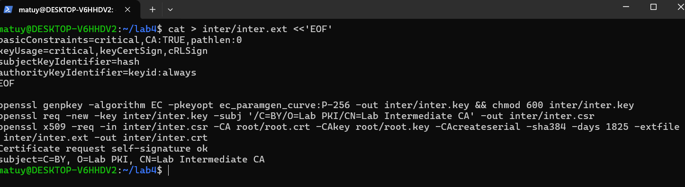

## 3. База промежуточного CA

    cd ~/lab4/inter && touch index.txt && echo 01 > crlnumber && echo 1000 > serial && cd ~/lab4
    cat > inter/ca.cnf <<'EOF'
    [ ca ]
    default_ca = CA_default
    [ CA_default ]
    dir              = /home/matuy/lab4/inter
    database         = $dir/index.txt
    new_certs_dir    = $dir
    serial           = $dir/serial
    crlnumber        = $dir/crlnumber
    certificate      = $dir/inter.crt
    private_key      = $dir/inter.key
    default_md       = sha384
    default_days     = 365
    default_crl_days = 30
    unique_subject   = no
    copy_extensions  = none
    policy           = policy_any
    [ policy_any ]
    commonName       = supplied
    EOF

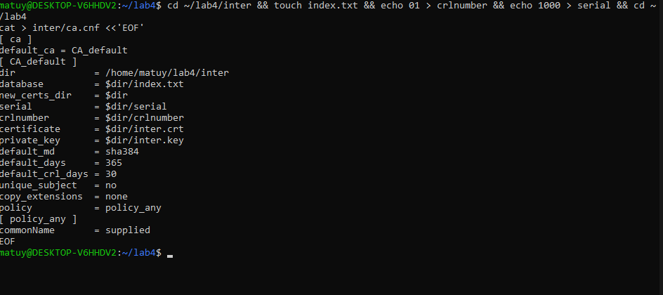

## 4. Серверный сертификат с SAN

    cat > server/server.ext <<'EOF'
    basicConstraints=critical,CA:FALSE
    keyUsage=critical,digitalSignature
    extendedKeyUsage=serverAuth
    subjectKeyIdentifier=hash
    authorityKeyIdentifier=keyid:always
    subjectAltName=DNS:localhost,IP:127.0.0.1
    EOF

    openssl genpkey -algorithm EC -pkeyopt ec_paramgen_curve:P-256 -out server/server.key && chmod 600 server/server.key
    openssl req -new -key server/server.key -subj '/C=BY/O=Lab PKI/CN=localhost' -out server/server.csr
    openssl ca -config inter/ca.cnf -batch -in server/server.csr -extfile server/server.ext -notext -out server/server.crt

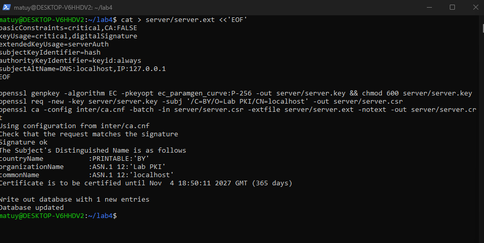

## 5. Проверка цепочки

    openssl verify -CAfile root/root.crt -untrusted inter/inter.crt server/server.crt
    openssl verify -CAfile root/root.crt server/server.crt
    openssl x509 -in server/server.crt -noout -ext subjectAltName,extendedKeyUsage,basicConstraints

### Позитивная проверка

    openssl verify -CAfile root/root.crt -untrusted inter/inter.crt server/server.crt

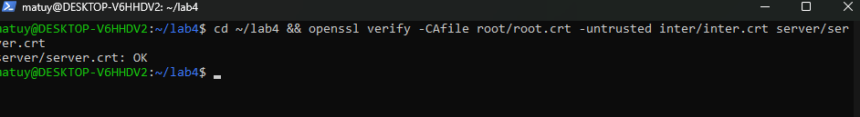

### Негативная проверка

    openssl verify -CAfile root/root.crt server/server.crt

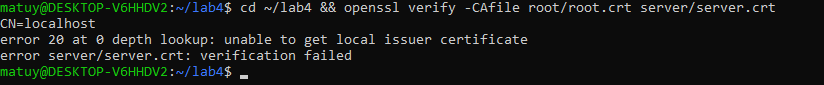

### Проверка сертификата

    openssl x509 -in server/server.crt -noout -ext subjectAltName,extendedKeyUsage,basicConstraints

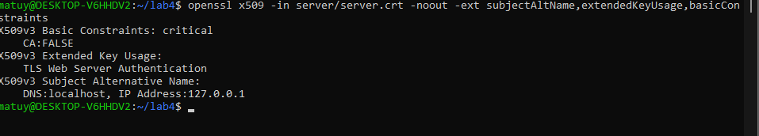

## 6 nginx: HTTPS только по TLS 1.3

    cat server/server.crt inter/inter.crt > server/fullchain.pem

    server {
    listen 8443 ssl;
    server_name localhost;
    ssl_certificate     /home/matuy/lab4/server/fullchain.pem;
    ssl_certificate_key /home/matuy/lab4/server/server.key;
    ssl_protocols TLSv1.3;
    ssl_conf_command Ciphersuites TLS_AES_256_GCM_SHA384;
    ssl_ecdh_curve X25519:P-384;
    ssl_session_tickets on;
    location / { return 200 'tls13 ok'; }
    }

    sudo nginx -t && sudo systemctl restart nginx

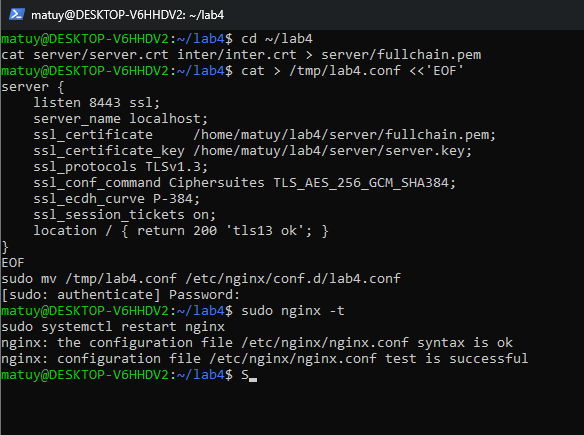

## 7. Проверка клиентом

### Позитивный тест с клиента:

    curl -v --cacert root/root.crt https://localhost:8443/

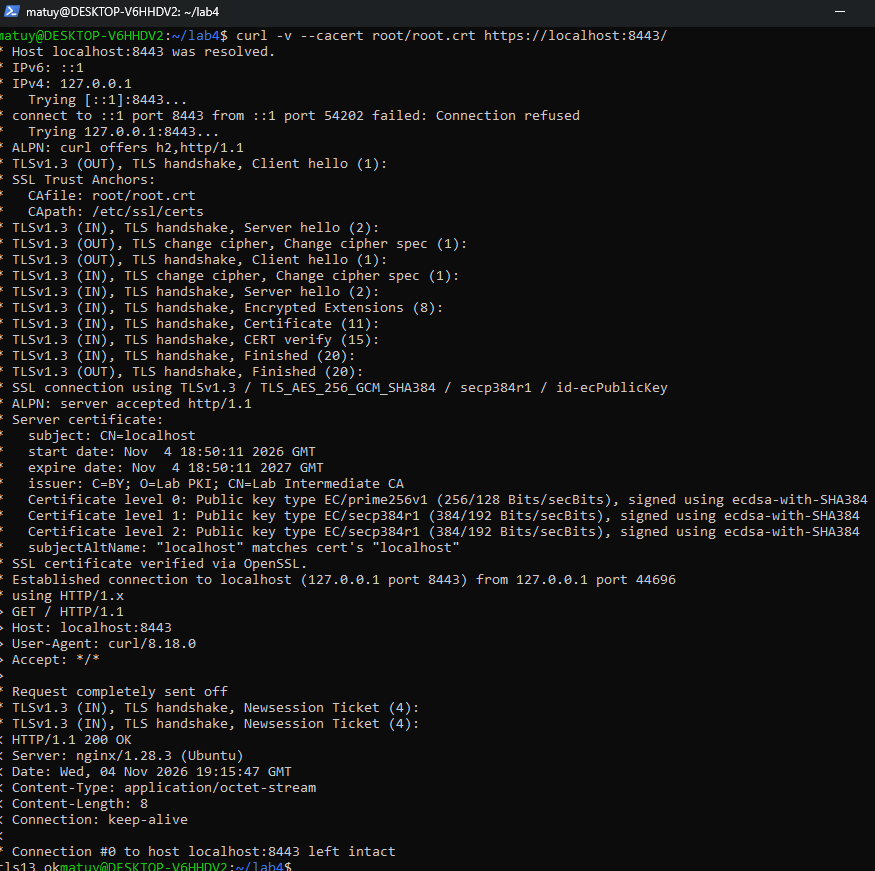

### Негативные тесты с клиента:

    curl https://localhost:8443/

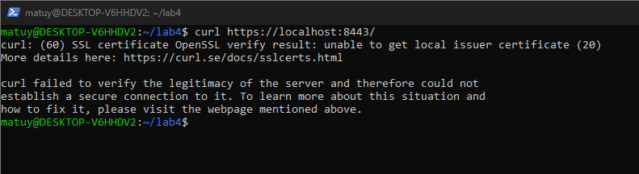

    curl --cacert root/root.crt https://127.0.0.2:8443/

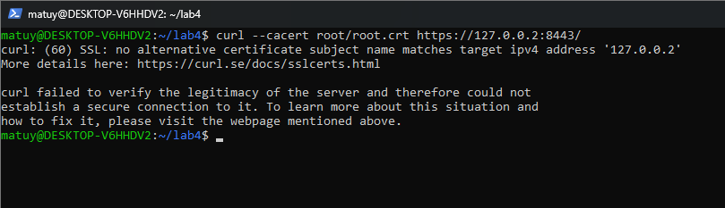

    openssl genpkey -algorithm EC -pkeyopt ec_paramgen_curve:P-256 -out /tmp/other.key
    openssl req -new -x509 -key /tmp/other.key -subj '/CN=Other Root' -days 1 -out /tmp/other.crt
    curl --cacert /tmp/other.crt https://localhost:8443/

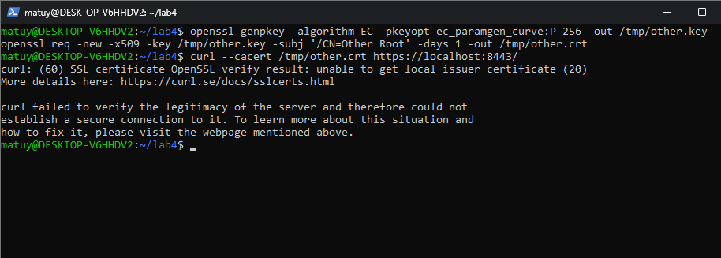

    ( sleep 1 ) | openssl s_client -connect localhost:8443 -tls1_2 -CAfile root/root.crt 2>&1 | grep -E 'alert|Protocol'
 
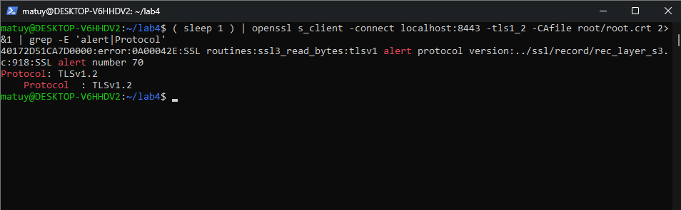

## 8. Захват рукопожатия и журнал ключей

для этого задания нужно открыть 2 оболочки (левая будет клиентом, а правая будет перехватывать пакеты трафика от левой):
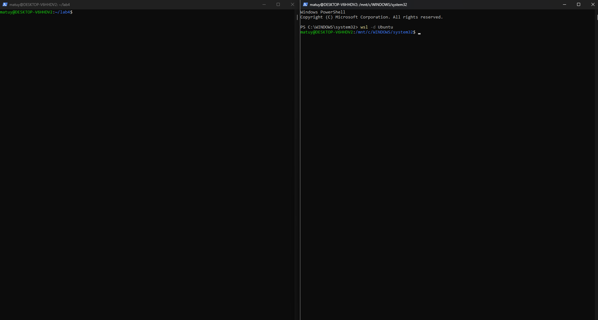

затем нам нужно на одной запустить tcpdump для прослушивания (перехвата и анализа трафика):

    sudo tcpdump -i lo -w ~/lab4/client/handshake.pcap 'tcp port 8443'

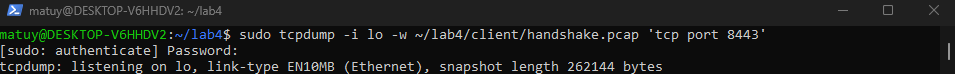

после я запустил клиентскую часть и он успешно передал трафик:

    cd ~/lab4/client
    SSLKEYLOGFILE=$HOME/lab4/client/keys.log curl -sS --cacert ../root/root.crt https://localhost:8443/

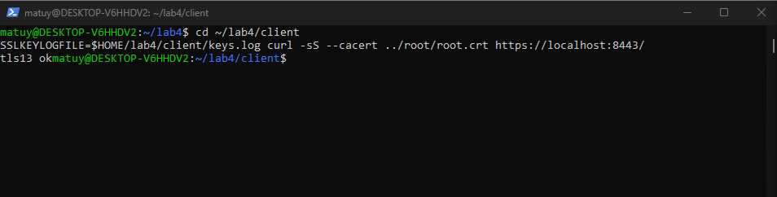

затем остановил tcpdump:

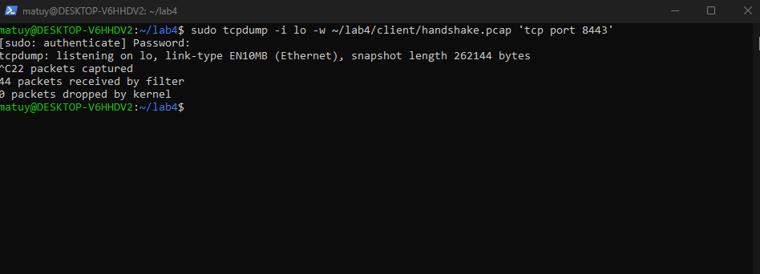

затем передал права пользователю (мне(matuy)) и просмотрел и там 5 строк (все как и должно быть)

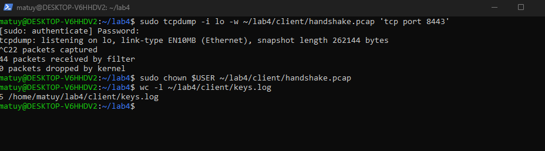

## 9. Анализ в Wireshark (tshark)

В терминале где была клиентская часть (левая) анализируем без ключей

    tshark -r handshake.pcap -Y tls -T fields -e frame.number -e tls.record.content_type -e tls.handshake.type

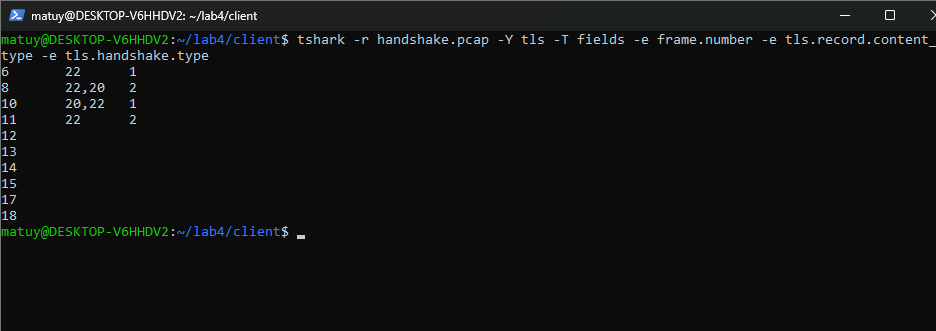

В терминале где была клиентская часть (левая) анализируем с ключами

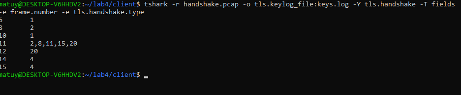

Поля для отчета:

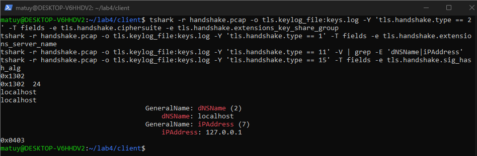

## 10. Индивидуальный вариант задания: HelloRetryRequest: клиент первым присылает key_share для X25519, сервер принимает только P-384. Найдите HRR в захвате (Hello Retry Request, Selected Group). Сервер — openssl s_server, пример в шаге 10

Для этого мне понадобится 3 терминала. в первом я ввожу:

    openssl s_server -accept 8453 -cert server/server.crt -key server/server.key -cert_chain inter/inter.crt -tls1_3 -groups P-384 -ciphersuites TLS_AES_256_GCM_SHA384 -www

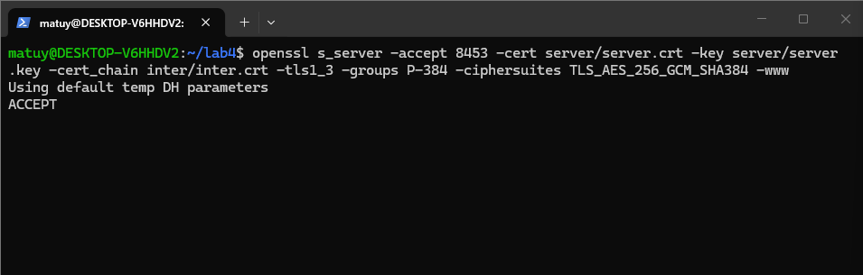

Затем в втором терминале я начинаю прослушить порт 8453

    sudo tcpdump -i lo -w ~/lab4/client/hrr.pcap 'tcp port 8453'

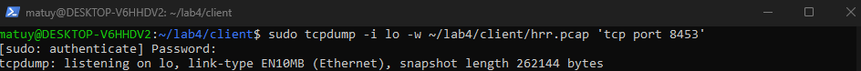

После в третьем терминале:

    ( sleep 1 ) | openssl s_client -connect localhost:8453 -servername localhost -CAfile root/root.crt -tls1_3 -groups X25519:P-384 -brief

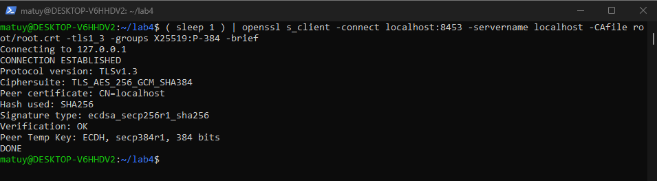

Я завершаю прослушивание порта и делаю шаги похожие в шаге 8:

    sudo chown $USER ~/lab4/client/hrr.pcap
    tshark -r ~/lab4/client/hrr.pcap -Y 'tls.handshake.type == 1 or tls.handshake.type == 2' -T fields -e frame.number -e tls.handshake.type

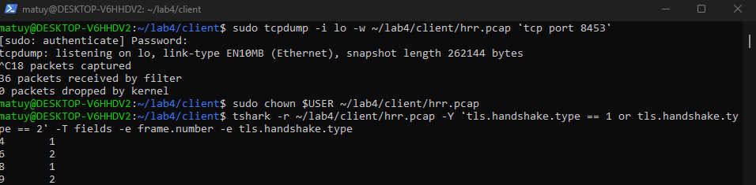

# Вывод

в течении работы над лабораторной работы я больше разобрался в взаимодействии протоколов между собой, где они применяются, также как работает удостоверяющий центр и способы создания ключей им и использования этих удостоверяющий ключей. Также разница в работе (фактической реализации) протоколов
