<p align="center">Министерство образования Республики Беларусь</p>
<p align="center">Учреждение образования</p>
<p align="center">“Брестский Государственный технический университет”</p>
<p align="center">Кафедра ИИТ</p>
<br><br><br><br><br><br><br>
<p align="center">Лабораторная работа №4</p>
<p align="center">По дисциплине “Криптографические методы защиты информации”</p>
<p align="center">Тема: “PKI, HTTPS и TLS 1.3. Развертывание тестового Удостоверяющего Центра (CA), выпуск сертификатов X.509, настройка HTTPS-сервера и анализ рукопожатия TLS 1.3 в Wireshark”</p>
<p align="center">Вариант: 12</p>
<br><br><br><br><br>
<p align="right">Выполнил:</p>
<p align="right">Студент 3 курса</p>
<p align="right">Группы ИИ-27</p>
<p align="right">Юшкевич А.Ю.</p>
<p align="right">Проверил:</p>
<p align="right">Хацкевич А.С.</p>
<br><br><br><br><br>
<p align="center">Брест 2026</p>

---

# Цель
    на собственном тестовом CA выпустить цепочку сертификатов X.509 с расширениями, настроить HTTPS-сервер, принимающий только TLS 1.3, проверить цепочку доверия и отзыв, захватить рукопожатие TLS 1.3 и разобрать его в Wireshark, в том числе после расшифровки через журнал ключей (SSLKEYLOGFILE).


# Вариант 12
| №  | Ключ корня / промежуточного CA | Ключ сервера | Группа ECDHE | Набор шифров TLS 1.3         | Задача варианта                                                                                                                                                                                                                                                                                                                                                |
|----|--------------------------------|--------------|--------------|------------------------------|----------------------------------------------------------------------------------------------------------------------------------------------------------------------------------------------------------------------------------------------------------------------------------------------------------------------------------------------------------------|
| 12 | RSA-2048                       | Ed25519      | X25519       | TLS_AES_256_GCM_SHA384       | mTLS с клиентским сертификатом Ed25519: без сертификата соединение отвергается, с сертификатом проходит. Для nginx без клиентского сертификата ответ — HTTP 400 No required SSL certificate was sent, а не TLS-alert. Объясните разницу                                                                                                                        |


# Ход работы

Сначала я установил необходимые дистрибутивы: 
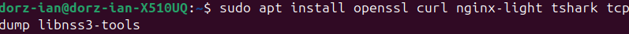

затем создаю рабочий каталог каталоге ```~/lab4```.

## 1. Корневой CA

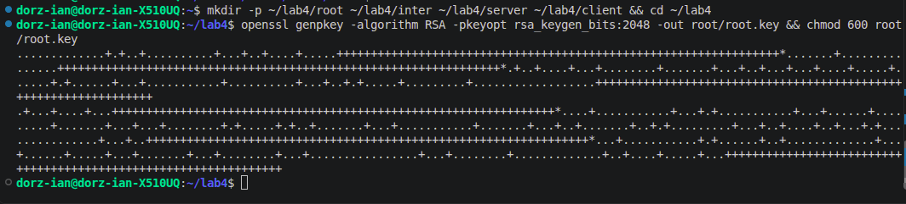
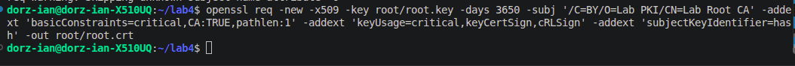

## 2. Промежуточный CA 


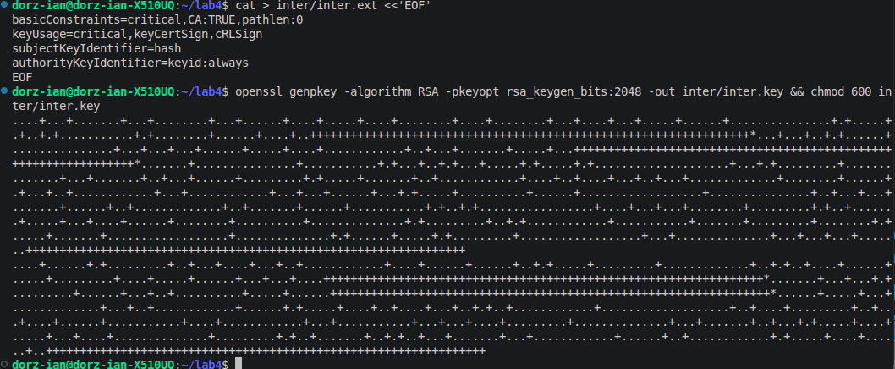
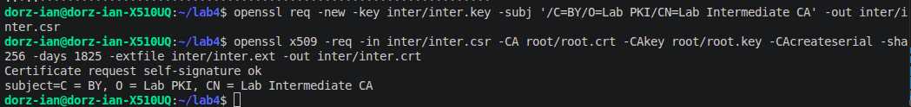

## 3. База промежуточного CA

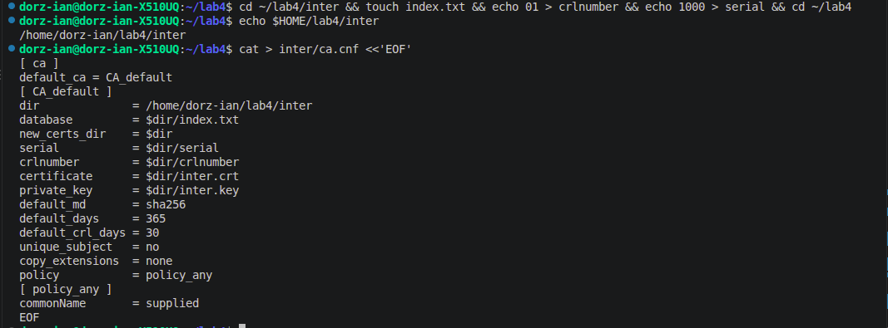


## 4. Серверный сертификат с SAN


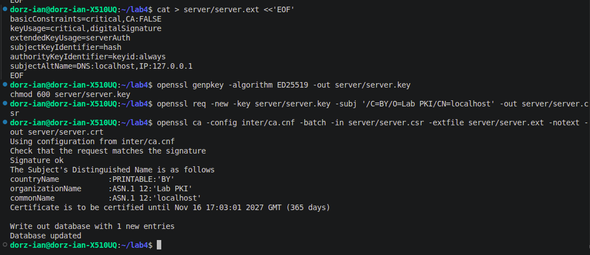

## 5. Проверка цепочки

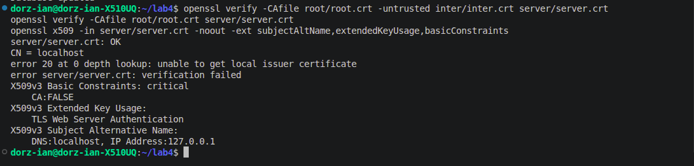

### Негативная проверка

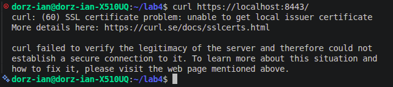
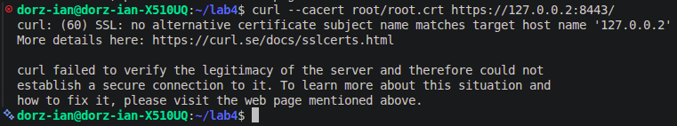
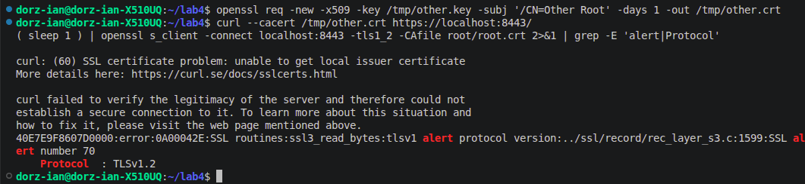

## 6 nginx: HTTPS только по TLS 1.3

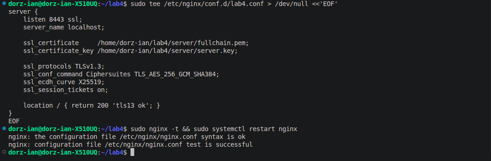

## 7. Захват рукопожатия и журнал ключей

проверка клиентом

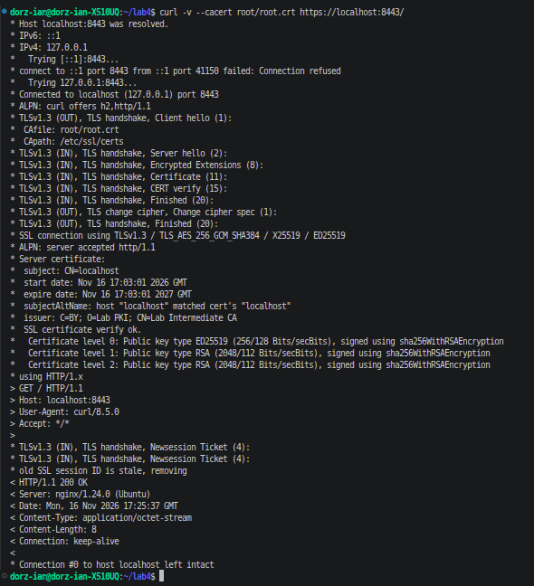

для этого задания нужно открыть 2 терминала.

затем нам нужно на одной запустить tcpdump для прослушивания (перехвата и анализа трафика):

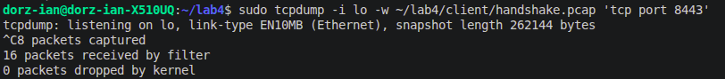

после я запустил клиентскую часть и он успешно передал трафик:

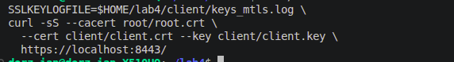

## 8. Анализ в Wireshark (tshark)

В терминале где была клиентская часть анализируем без ключей

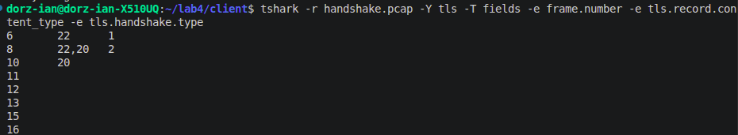

В терминале где была клиентская часть анализируем с ключами

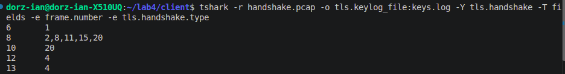


## 9. Индивидуальный вариант задания: mTLS с клиентским сертификатом Ed25519: без сертификата соединение отвергается, с сертификатом проходит. Для nginx без клиентского сертификата ответ — HTTP 400 No required SSL certificate was sent, а не TLS-alert.

настрйока nginx mTLS

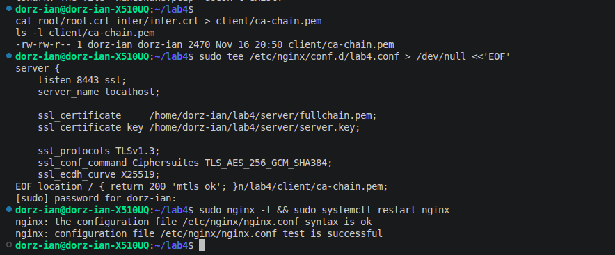

mTLS с клиентским сертификатом Ed25519: без сертификата соединение отвергается

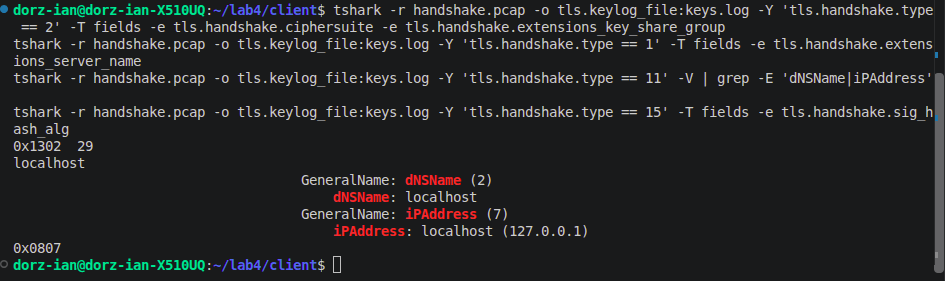

с mTLS

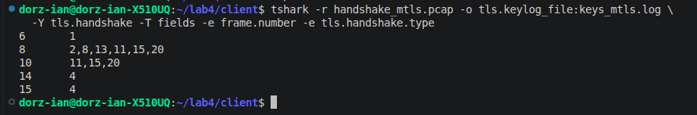

### Почему так или в чем разница?

В первом варианте, так как mTLS не был включен, то мы получили подпись только сервера, а клиент не отправлял свой сертификат. В кадре 8 видно, что 13 - это запрос сервера на клиентский сертификат, на что клиент отпрвил свои сертификаты - 11, 15 в кадре 10. Вся разница в том, что в старом захвате в кадре 10 клиент отправлял только подтверждение завершения рукопожатия, а в новом - сертификат и подпись.


# Вывод

в течении работы над лабораторной работы я больше разобрался в взаимодействии протоколов между собой, где они применяются, также как работает удостоверяющий центр и способы создания ключей им и использования этих удостоверяющий ключей. Также разница в работе (фактической реализации) протоколов