<p align="center">Министерство образования Республики Беларусь</p>
<p align="center">Учреждение образования</p>
<p align="center">“Брестский Государственный технический университет”</p>
<p align="center">Кафедра ИИТ</p>
<br><br><br><br><br><br><br>
<p align="center">Лабораторная работа №4</p>
<p align="center">По дисциплине “Криптографические методы защиты информации”</p>
<p align="center">Тема: “PKI, HTTPS и TLS 1.3. Развертывание тестового Удостоверяющего Центра (CA), выпуск сертификатов X.509, настройка HTTPS-сервера и анализ рукопожатия TLS 1.3 в Wireshark”</p>
<p align="center">Вариант: 11</p>
<br><br><br><br><br>
<p align="right">Выполнил:</p>
<p align="right">Студент 3 курса</p>
<p align="right">Группы ИИ-28</p>
<p align="right">Цибульскас В.С.</p>
<p align="right">Проверил:</p>
<p align="right">Хацкевич А.С.</p>
<br><br><br><br><br>
<p align="center">Брест 2026</p>

---

# Цель

На собственном тестовом CA выпустить цепочку сертификатов X.509 с расширениями, настроить HTTPS-сервер, принимающий только TLS 1.3, проверить цепочку доверия и отзыв, захватить рукопожатие TLS 1.3 и разобрать его в Wireshark, в том числе после расшифровки через журнал ключей (`SSLKEYLOGFILE`).

# Вариант 11

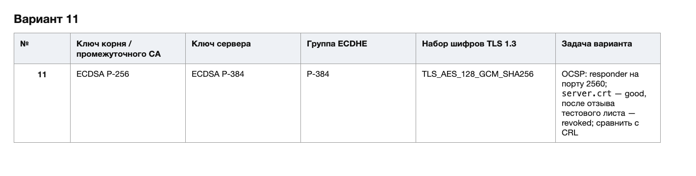

Параметры варианта:

| Параметр | Значение |
|---|---|
| Ключ корневого CA | ECDSA P-256 |
| Ключ промежуточного CA | ECDSA P-256 |
| Ключ сервера | ECDSA P-384 |
| Группа ECDHE | P-384 |
| Набор шифров TLS 1.3 | `TLS_AES_128_GCM_SHA256` (`0x1301`) |
| Задача варианта | OCSP: `good` → `revoked`, сравнение с CRL |

# Структура сертификатов

Цепочка доверия:

```text
Lab Root CA (root/root.crt, ECDSA P-256, self-signed)
└── Lab Intermediate CA (inter/inter.crt, ECDSA P-256)
    ├── server.crt   (CN=localhost, ECDSA P-384, serverAuth)
    ├── revoked.crt  (CN=revoked.localhost, ECDSA P-384, serverAuth)
    └── expired.crt  (CN=expired.localhost, ECDSA P-384, serverAuth)
```

| Сертификат | Subject | Issuer | Ключ | Срок | basicConstraints | keyUsage | EKU | SAN |
|---|---|---|---|---|---|---|---|---|
| `root.crt` | `C=BY, O=Lab PKI, CN=Lab Root CA` | сам себе | ECDSA P-256 | 3650 дней | `CA:TRUE, pathlen:1` | `keyCertSign, cRLSign` | — | — |
| `inter.crt` | `C=BY, O=Lab PKI, CN=Lab Intermediate CA` | `root.crt` | ECDSA P-256 | 1825 дней | `CA:TRUE, pathlen:0` | `keyCertSign, cRLSign` | — | — |
| `server.crt` | `CN=localhost` | `inter.crt` | ECDSA P-384 | 365 дней | `CA:FALSE` | `digitalSignature` | `serverAuth` | `DNS:localhost, IP:127.0.0.1` |
| `revoked.crt` | `CN=revoked.localhost` | `inter.crt` | ECDSA P-384 | 365 дней | `CA:FALSE` | `digitalSignature` | `serverAuth` | `DNS:revoked.localhost` |
| `expired.crt` | `CN=expired.localhost` | `inter.crt` | ECDSA P-384 | 2020-01-01 — 2021-01-01 | `CA:FALSE` | `digitalSignature` | `serverAuth` | `DNS:expired.localhost` |

Дополнительно:

* `fullchain.pem` = `server.crt` + `inter.crt`; корневой сертификат в файл не включается, клиент берёт его из своего хранилища (`--cacert root/root.crt`).
* У `inter.crt`, `server.crt` и `revoked.crt` заполнены `subjectKeyIdentifier` и `authorityKeyIdentifier`; у `root.crt` — `subjectKeyIdentifier`.
* У `server.crt` и `revoked.crt` есть AIA `OCSP;URI:http://127.0.0.1:2560`.
* `pathlen:1` у корня разрешает один промежуточный CA, `pathlen:0` у промежуточного CA запрещает выпускать CA ниже него.

Клиент проверяет путь сертификации по RFC 5280:

1. подпись каждого сертификата открытым ключом издателя;
2. текущее время в интервале `Not Before` — `Not After`;
3. `basicConstraints`, `pathlen` и `keyUsage` у каждого CA;
4. `extendedKeyUsage=serverAuth` у листа;
5. отсутствие отзыва через OCSP или CRL;
6. совпадение имени хоста с SAN листа.

# Ход работы

## 0. Окружение

Работа выполнялась на macOS 27.2 (Darwin 27.2.0, arm64). Использовались OpenSSL 3.6.5 (Homebrew), nginx 1.31.8 (Homebrew), tshark 4.6.9 и curl 8.7.1. Системный `/usr/bin/openssl` в macOS — это LibreSSL, поэтому для всех команд явно используется OpenSSL 3.x из Homebrew.

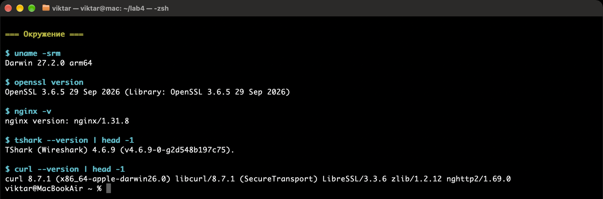

Каталог работы — `~/lab4`:

```bash
mkdir -p ~/lab4/{root,inter,server,client,revoked,expired,nginx}
cd ~/lab4
```

## 1. Корневой CA

Корневой CA создаётся на ECDSA P-256. В сертификате задаются `basicConstraints=critical,CA:TRUE,pathlen:1`, `keyUsage=critical,keyCertSign,cRLSign` и `subjectKeyIdentifier`.

```bash
openssl genpkey -algorithm EC -pkeyopt ec_paramgen_curve:P-256 -out root/root.key
chmod 600 root/root.key

openssl req -new -x509 -key root/root.key -sha256 -days 3650 \
  -subj '/C=BY/O=Lab PKI/CN=Lab Root CA' \
  -addext 'basicConstraints=critical,CA:TRUE,pathlen:1' \
  -addext 'keyUsage=critical,keyCertSign,cRLSign' \
  -addext 'subjectKeyIdentifier=hash' \
  -out root/root.crt
```

Проверка полей:

```bash
openssl x509 -in root/root.crt -noout -subject -issuer -dates \
  -ext basicConstraints,keyUsage
```

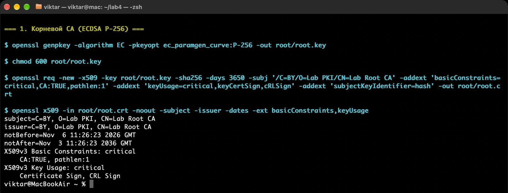

`pathlen:1` разрешает корню выпустить один промежуточный CA, но не больше.

## 2. Промежуточный CA

Промежуточный CA тоже на ECDSA P-256. Для него задаётся `pathlen:0`: он может выпускать конечные сертификаты, но не другие CA.

```bash
cat > inter/inter.ext <<'EOF'
basicConstraints=critical,CA:TRUE,pathlen:0
keyUsage=critical,keyCertSign,cRLSign
subjectKeyIdentifier=hash
authorityKeyIdentifier=keyid:always
EOF

openssl genpkey -algorithm EC -pkeyopt ec_paramgen_curve:P-256 -out inter/inter.key
chmod 600 inter/inter.key

openssl req -new -key inter/inter.key \
  -subj '/C=BY/O=Lab PKI/CN=Lab Intermediate CA' \
  -out inter/inter.csr

openssl x509 -req -in inter/inter.csr \
  -CA root/root.crt -CAkey root/root.key -CAcreateserial \
  -sha256 -days 1825 -extfile inter/inter.ext \
  -out inter/inter.crt
```

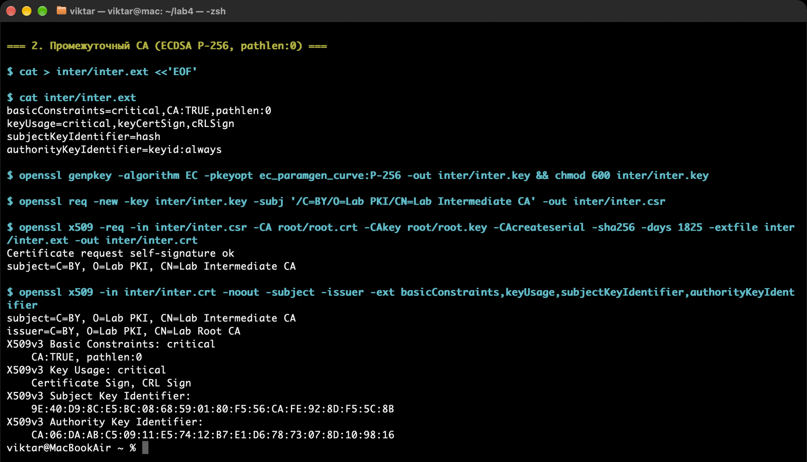

В выводе видны `CA:TRUE, pathlen:0`, `keyCertSign`, `cRLSign`, Subject Key Identifier и Authority Key Identifier.

## 3. База промежуточного CA

Сертификаты и CRL выпускаются через `openssl ca`, поэтому нужна база `index.txt`, счётчик серийных номеров и счётчик CRL.

```bash
cd inter
touch index.txt
echo 01 > crlnumber
echo 1000 > serial
cd ..
```

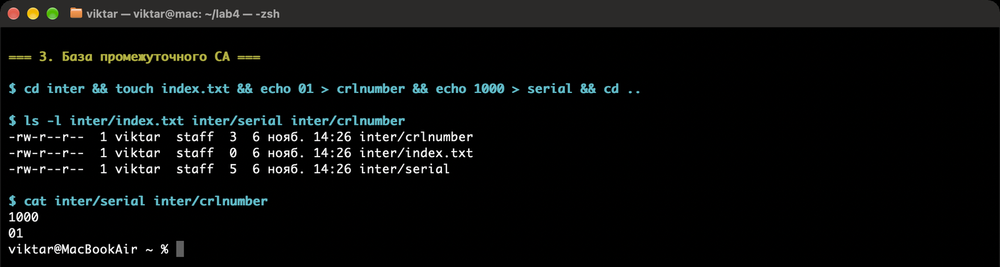

Конфигурация `inter/ca.cnf`:

```ini
[ ca ]
default_ca = CA_default

[ CA_default ]
dir              = /Users/viktar/lab4/inter
database         = $dir/index.txt
new_certs_dir    = $dir
serial           = $dir/serial
crlnumber        = $dir/crlnumber
certificate      = $dir/inter.crt
private_key      = $dir/inter.key
default_md       = sha256
default_days     = 365
default_crl_days = 30
unique_subject   = no
copy_extensions  = none
policy           = policy_any

[ policy_any ]
commonName       = supplied
```

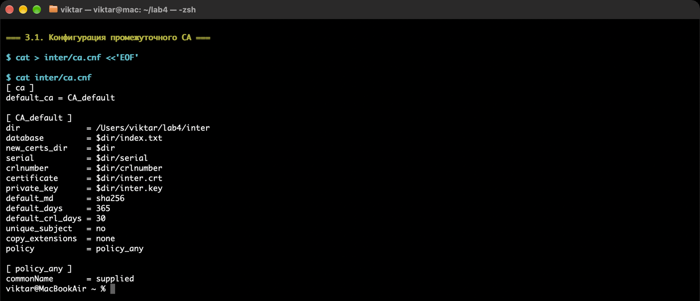

`unique_subject = no` позволяет повторно выпускать сертификаты с тем же Subject, а `copy_extensions = none` означает, что расширения берутся из отдельного `-extfile`, а не из CSR.

## 4. Серверный сертификат с SAN

Серверный ключ — ECDSA P-384. В сертификате заданы SAN `DNS:localhost,IP:127.0.0.1`, EKU `serverAuth`, `keyUsage=digitalSignature`, `CA:FALSE` и AIA с адресом OCSP-responder.

```bash
cat > server/server.ext <<'EOF'
basicConstraints=critical,CA:FALSE
keyUsage=critical,digitalSignature
extendedKeyUsage=serverAuth
subjectKeyIdentifier=hash
authorityKeyIdentifier=keyid:always
subjectAltName=DNS:localhost,IP:127.0.0.1
authorityInfoAccess=OCSP;URI:http://127.0.0.1:2560
EOF

openssl genpkey -algorithm EC -pkeyopt ec_paramgen_curve:P-384 -out server/server.key
chmod 600 server/server.key

openssl req -new -key server/server.key \
  -subj '/C=BY/O=Lab PKI/CN=localhost' \
  -out server/server.csr

openssl ca -config inter/ca.cnf -batch \
  -in server/server.csr -extfile server/server.ext \
  -notext -out server/server.crt
```

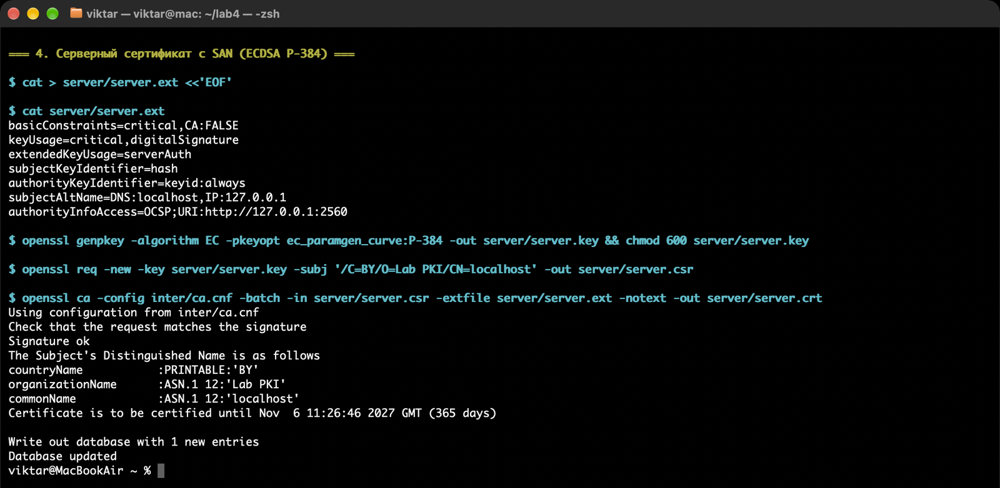

Проверка расширений и сборка полной цепочки:

```bash
openssl x509 -in server/server.crt -noout -subject -issuer \
  -ext basicConstraints,keyUsage,extendedKeyUsage,subjectAltName,authorityInfoAccess

cat server/server.crt inter/inter.crt > server/fullchain.pem
grep -c 'BEGIN CERTIFICATE' server/fullchain.pem
```

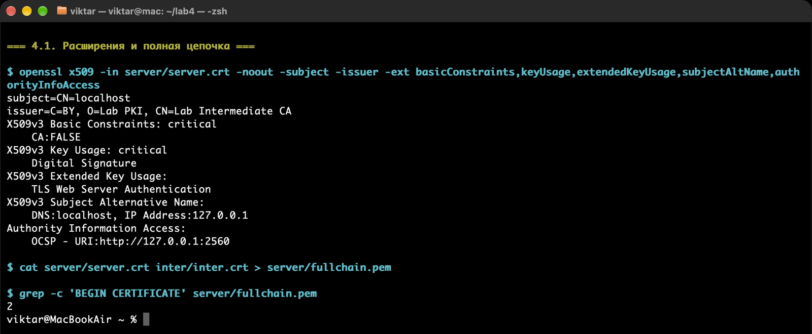

`fullchain.pem` содержит два сертификата: сначала лист `localhost`, затем промежуточный CA. Именно этот файл отдаёт nginx, иначе клиент не построит цепочку до корня.

## 5. Тестовые сертификаты для отзыва и истечения

Серверный сертификат отзывать нельзя: после отзыва придётся перевыпускать его и перезапускать nginx. Поэтому для варианта 11 выпускается отдельный тестовый лист `revoked.localhost` на ECDSA P-384.

```bash
cat > revoked/revoked.ext <<'EOF'
basicConstraints=critical,CA:FALSE
keyUsage=critical,digitalSignature
extendedKeyUsage=serverAuth
subjectKeyIdentifier=hash
authorityKeyIdentifier=keyid:always
subjectAltName=DNS:revoked.localhost
authorityInfoAccess=OCSP;URI:http://127.0.0.1:2560
EOF

openssl genpkey -algorithm EC -pkeyopt ec_paramgen_curve:P-384 -out revoked/revoked.key
chmod 600 revoked/revoked.key

openssl req -new -key revoked/revoked.key \
  -subj '/C=BY/O=Lab PKI/CN=revoked.localhost' \
  -out revoked/revoked.csr

openssl ca -config inter/ca.cnf -batch \
  -in revoked/revoked.csr -extfile revoked/revoked.ext \
  -notext -out revoked/revoked.crt
```

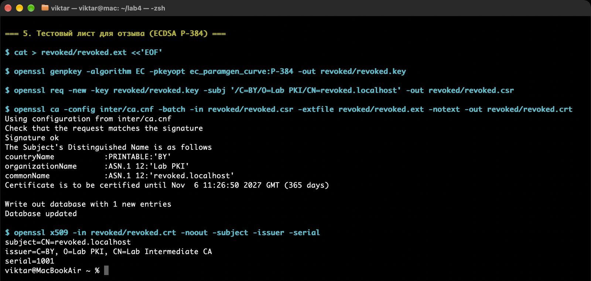

Для негативной проверки срока действия выпускается отдельный лист с датами в прошлом:

```bash
cat > expired/expired.ext <<'EOF'
basicConstraints=critical,CA:FALSE
keyUsage=critical,digitalSignature
extendedKeyUsage=serverAuth
subjectAltName=DNS:expired.localhost
EOF

openssl genpkey -algorithm EC -pkeyopt ec_paramgen_curve:P-384 -out expired/expired.key
chmod 600 expired/expired.key

openssl req -new -key expired/expired.key \
  -subj '/C=BY/O=Lab PKI/CN=expired.localhost' \
  -out expired/expired.csr

openssl ca -config inter/ca.cnf -batch \
  -in expired/expired.csr -extfile expired/expired.ext \
  -startdate 20200101000000Z -enddate 20210101000000Z \
  -notext -out expired/expired.crt
```

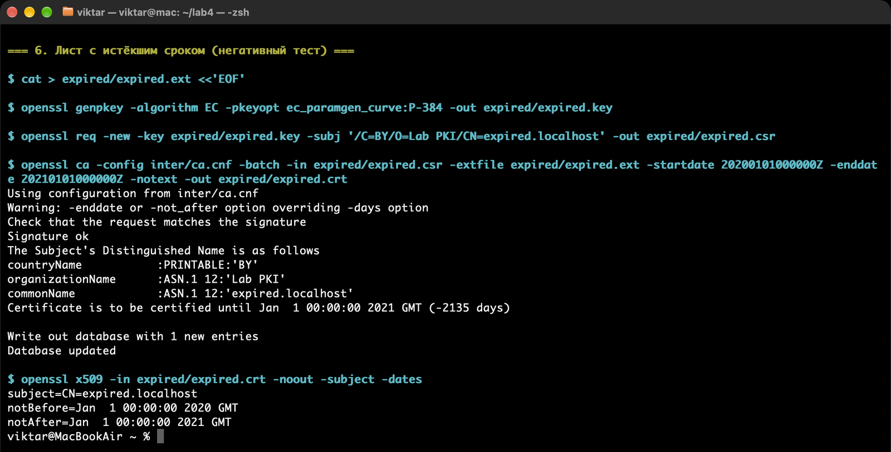

## 6. Проверка цепочки

Положительная проверка: клиент доверяет только корню, а промежуточный сертификат получает как untrusted.

```bash
openssl verify -CAfile root/root.crt -untrusted inter/inter.crt server/server.crt
openssl verify -CAfile root/root.crt -untrusted inter/inter.crt \
  -verify_hostname localhost server/server.crt
openssl verify -CAfile root/root.crt -untrusted inter/inter.crt \
  -verify_ip 127.0.0.1 server/server.crt
```

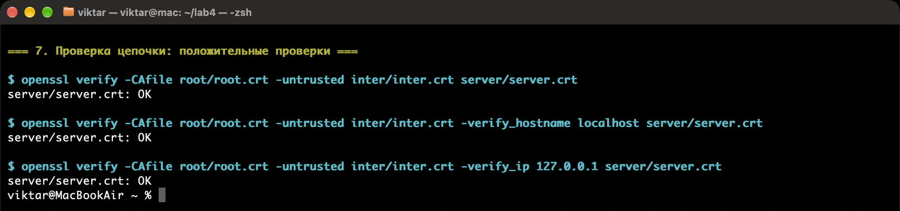

Негативные проверки:

* без промежуточного сертификата — `unable to get local issuer certificate`;
* с чужим корнем — `unable to get local issuer certificate`;
* имя вне SAN — `hostname mismatch` (код 62);
* IP вне SAN — `IP address mismatch` (код 64);
* истёкший сертификат — `certificate has expired` (код 10).

```bash
openssl genpkey -algorithm EC -pkeyopt ec_paramgen_curve:P-256 -out /tmp/other.key
openssl req -new -x509 -key /tmp/other.key -subj '/CN=Other Root' -days 1 -out /tmp/other.crt

openssl verify -CAfile root/root.crt server/server.crt
openssl verify -CAfile /tmp/other.crt -untrusted inter/inter.crt server/server.crt
openssl verify -CAfile root/root.crt -untrusted inter/inter.crt \
  -verify_hostname wrong.localhost server/server.crt
openssl verify -CAfile root/root.crt -untrusted inter/inter.crt \
  -verify_ip 127.0.0.2 server/server.crt
openssl verify -CAfile root/root.crt -untrusted inter/inter.crt expired/expired.crt
```

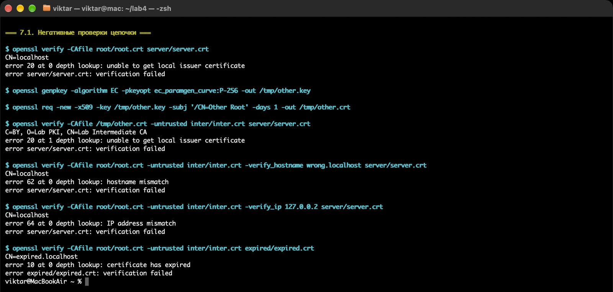

## 7. nginx: HTTPS только по TLS 1.3

Для варианта 11 в nginx заданы только TLS 1.3, один шифр `TLS_AES_128_GCM_SHA256` и группа `P-384`. В TLS 1.3 набор задаётся не через `ssl_ciphers`, а через `ssl_conf_command Ciphersuites`.

```nginx
server {
    listen 8443 ssl;
    server_name localhost;

    ssl_certificate     /Users/viktar/lab4/server/fullchain.pem;
    ssl_certificate_key /Users/viktar/lab4/server/server.key;

    ssl_protocols TLSv1.3;
    ssl_conf_command Ciphersuites TLS_AES_128_GCM_SHA256;
    ssl_ecdh_curve P-384;
    ssl_session_tickets on;

    location / { return 200 'tls13 ok'; }
}
```

На macOS nginx запускался без `sudo` на непривилегированном порту 8443 через локальную обёртку `nginx/nginx.conf`, которая подключает `lab4.conf`. На Linux этот же `lab4.conf` можно скопировать в `/etc/nginx/conf.d/`.

```bash
nginx -t -c /Users/viktar/lab4/nginx/nginx.conf
nginx -c /Users/viktar/lab4/nginx/nginx.conf
```

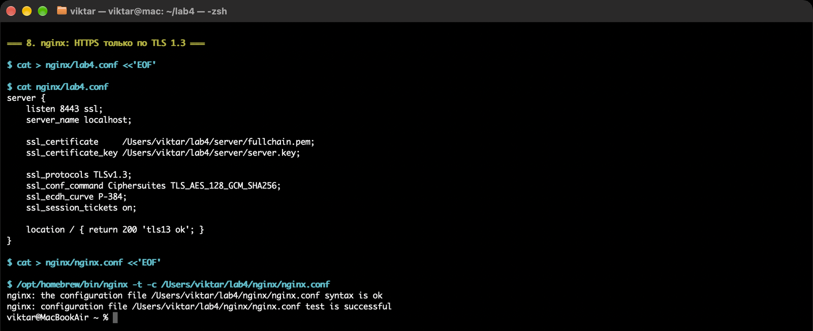

После запуска nginx слушает `*:8443`:

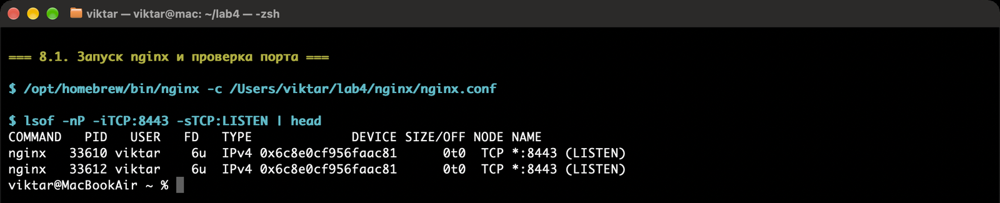

## 8. Проверка клиентом

Положительный тест: `curl` получает корень через `--cacert`, проверяет цепочку, SAN `localhost` и договаривается на TLS 1.3.

```bash
curl -v --cacert root/root.crt https://localhost:8443/
```

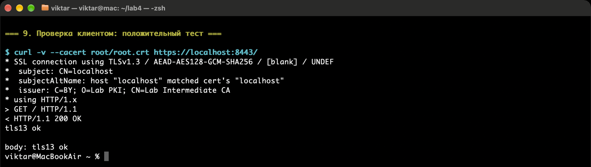

В выводе видны `SSL connection using TLSv1.3 / AEAD-AES128-GCM-SHA256`, `HTTP/1.1 200 OK` и тело `tls13 ok`.

Негативные тесты:

```bash
curl https://localhost:8443/
curl --cacert root/root.crt \
  --connect-to wrong.localhost:8443:127.0.0.1:8443 \
  https://wrong.localhost:8443/
curl --cacert /tmp/other.crt https://localhost:8443/
( sleep 1 ) | openssl s_client -connect localhost:8443 -tls1_2 \
  -CAfile root/root.crt 2>&1 | grep -E 'alert|Protocol'
```

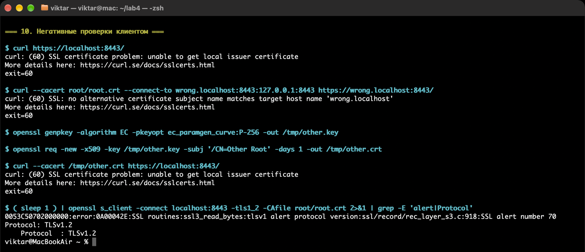

Ожидаемые результаты: без `--cacert` — exit 60 `unable to get local issuer certificate`; с именем вне SAN — exit 60 `no alternative certificate subject name matches target host name`; с чужим корнем — exit 60 `unable to get local issuer certificate`; TLS 1.2 — `alert protocol version`, код 70.

В macOS адрес `127.0.0.2` не был доступен для подключения, поэтому для проверки имени использован `--connect-to` на `127.0.0.1` с сохранением имени `wrong.localhost`; проверка IP вне SAN отдельно выполнена через `openssl verify -verify_ip 127.0.0.2`.

## 9. Захват рукопожатия и журнал ключей

Захват выполняется на loopback-интерфейсе. В macOS это `lo0`, в Linux — `lo`. `tcpdump` писал пакеты порта 8443 в `client/handshake.pcap`.

```bash
tcpdump -i lo0 -U -w client/handshake.pcap 'tcp port 8443' &
```

Клиент `openssl s_client` записывает секреты сессии в `client/keys.log` через `-keylogfile`. Переменная `SSLKEYLOGFILE` для `s_client` не работает; в macOS curl собран с SecureTransport и журнал ключей также не пишет.

```bash
openssl s_client -connect localhost:8443 -servername localhost \
  -CAfile root/root.crt -tls1_3 -groups P-384 \
  -keylogfile client/keys.log -brief
```

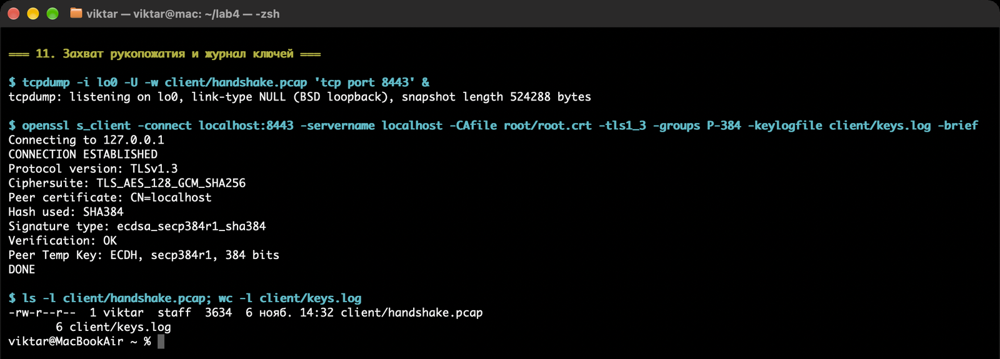

В журнале шесть строк: заголовок и пять секретов. Список меток:

```bash
cut -d' ' -f1 client/keys.log | sort -u
```

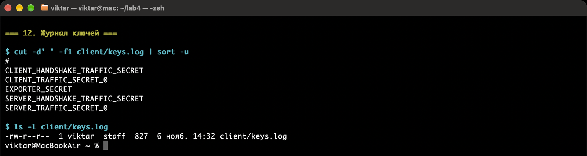

## 10. Анализ в tshark

Без журнала ключей видны только `ClientHello` (тип 1) и `ServerHello` (тип 2). Остальные сообщения TLS 1.3 находятся внутри записей `application_data`; в tshark 4.6 фактический тип записи удобно смотреть через `tls.record.opaque_type` (23), потому что `tls.record.content_type` для зашифрованных записей может быть пустым.

```bash
tshark -r client/handshake.pcap -Y tls -T fields \
  -e frame.number -e tls.record.content_type \
  -e tls.record.opaque_type -e tls.handshake.type
```

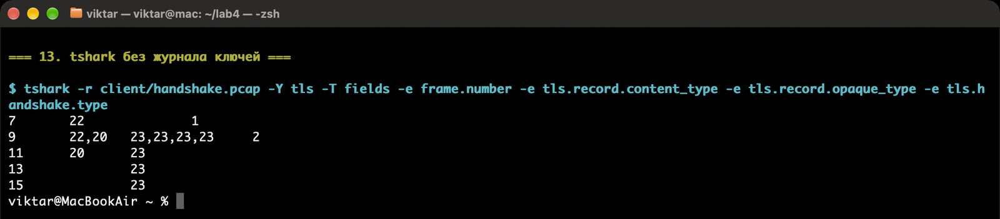

С журналом ключей видны `EncryptedExtensions` (8), `Certificate` (11), `CertificateVerify` (15), `Finished` (20) и `NewSessionTicket` (4).

```bash
tshark -r client/handshake.pcap -o tls.keylog_file:client/keys.log \
  -Y tls.handshake -T fields -e frame.number -e tls.handshake.type
```

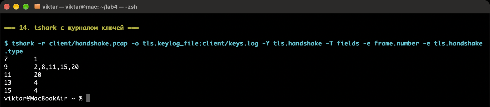

Параметры рукопожатия:

```bash
tshark -r client/handshake.pcap -o tls.keylog_file:client/keys.log \
  -Y 'tls.handshake.type == 2' -T fields \
  -e tls.handshake.ciphersuite -e tls.handshake.extensions_key_share_group

tshark -r client/handshake.pcap -o tls.keylog_file:client/keys.log \
  -Y 'tls.handshake.type == 1' -T fields \
  -e tls.handshake.extensions_server_name

tshark -r client/handshake.pcap -o tls.keylog_file:client/keys.log \
  -Y 'tls.handshake.type == 11' -V | grep -E 'dNSName|iPAddress'

tshark -r client/handshake.pcap -o tls.keylog_file:client/keys.log \
  -Y 'tls.handshake.type == 15' -T fields \
  -e tls.handshake.sig_hash_alg
```

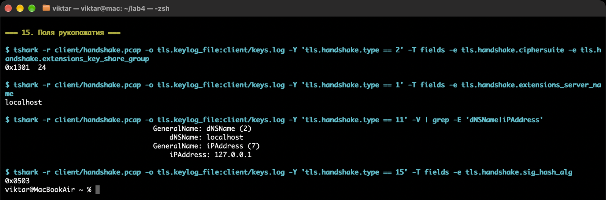

Полученные значения:

| Поле | Значение |
|---|---|
| Шифр | `0x1301` — `TLS_AES_128_GCM_SHA256` |
| Группа `key_share` | `24` — P-384 (`secp384r1`) |
| SNI | `localhost` |
| SAN сертификата | `dNSName: localhost`, `iPAddress: 127.0.0.1` |
| Подпись `CertificateVerify` | `0x0503` — `ecdsa_secp384r1_sha384` |

## 11. Индивидуальное задание: OCSP

Для варианта 11 поднимается OCSP-responder на порту 2560. Он подписывает ответы ключом промежуточного CA и читает базу `inter/index.txt` при старте.

```bash
openssl ocsp -index inter/index.txt -port 2560 \
  -rsigner inter/inter.crt -rkey inter/inter.key \
  -CA inter/inter.crt -text
```

Запрос статуса серверного и ещё не отозванного тестового сертификата:

```bash
openssl ocsp -issuer inter/inter.crt -cert server/server.crt \
  -url http://127.0.0.1:2560 -CAfile root/root.crt -no_nonce

openssl ocsp -issuer inter/inter.crt -cert revoked/revoked.crt \
  -url http://127.0.0.1:2560 -CAfile root/root.crt -no_nonce
```

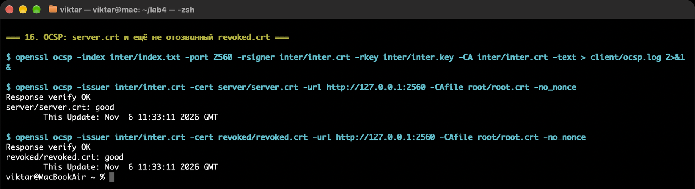

Оба ответа — `good`, подпись ответа проверяется (`Response verify OK`).

Теперь отзывается только тестовый лист `revoked.crt`, а не серверный сертификат:

```bash
openssl ca -config inter/ca.cnf -batch -revoke revoked/revoked.crt
openssl ca -config inter/ca.cnf -batch -gencrl -out inter/inter.crl
```

Responder читает `index.txt` при старте, поэтому после отзыва его нужно перезапустить. После перезапуска:

```bash
openssl ocsp -issuer inter/inter.crt -cert server/server.crt \
  -url http://127.0.0.1:2560 -CAfile root/root.crt -no_nonce
# server.crt: good

openssl ocsp -issuer inter/inter.crt -cert revoked/revoked.crt \
  -url http://127.0.0.1:2560 -CAfile root/root.crt -no_nonce
# revoked.crt: revoked
```

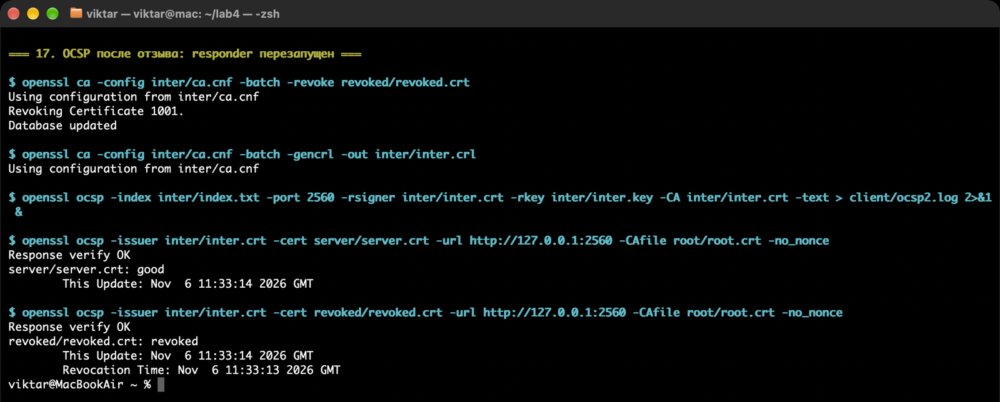

Серверный сертификат остаётся `good`, отозванный тестовый — `revoked`.

### Сравнение с CRL

Тот же отзыв можно проверить по CRL. В CRL попадает серийный номер `1001` (revoked.crt), а серийного номера `1000` (server.crt) там нет.

```bash
openssl crl -in inter/inter.crl -noout -text
openssl verify -crl_check -CAfile root/root.crt \
  -untrusted inter/inter.crt -CRLfile inter/inter.crl server/server.crt
openssl verify -crl_check -CAfile root/root.crt \
  -untrusted inter/inter.crt -CRLfile inter/inter.crl revoked/revoked.crt
```

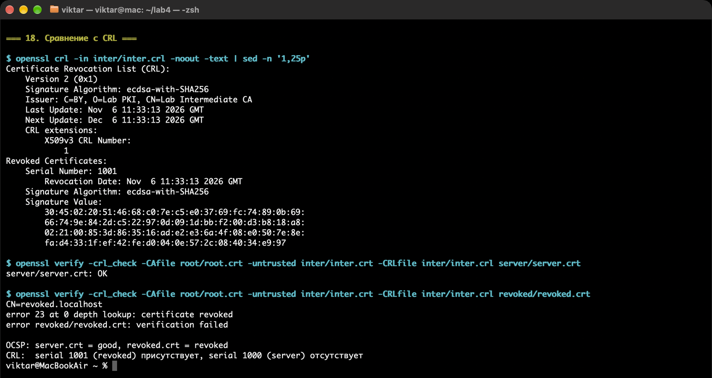

Результат:

| Сертификат | OCSP | CRL |
|---|---|---|
| `server.crt` | `good` | `OK` (не отозван) |
| `revoked.crt` | `revoked` | `error 23: certificate revoked` |

OCSP отвечает про один сертификат онлайн и позволяет получить статус без скачивания всего списка. CRL — это подписанный CA список всех отозванных сертификатов; клиент скачивает его целиком, и со временем список растёт. В работе оба механизма дали согласованный результат: `server.crt` действителен, `revoked.crt` отозван.

# Вывод

В ходе работы был развёрнут тестовый удостоверяющий центр с корневым и промежуточным CA, выпущена цепочка X.509 с `pathlen`, `keyUsage`, `extendedKeyUsage`, SAN и AIA. Проверка `openssl verify` подтвердила, что цепочка строится только при наличии промежуточного сертификата, а неверное имя, IP, чужой корень и истёкший срок корректно отвергаются.

nginx был настроен на TLS 1.3 с `TLS_AES_128_GCM_SHA256` и группой P-384; `curl` получил `HTTP 200` и тело `tls13 ok`, а TLS 1.2 был отвергнут alert-ом `protocol version` (70). В захвате `tls.handshake.ciphersuite` равен `0x1301`, группа `key_share` — `24` (P-384), SNI — `localhost`, подпись `CertificateVerify` — `0x0503`.

В индивидуальном задании был поднят OCSP-responder: серверный сертификат получил статус `good`, тестовый лист после отзыва — `revoked`. Повторный запрос после перезапуска responder подтвердил, что он перечитывает `index.txt`. CRL для того же отзыва содержит серийный номер `1001` и не содержит `1000`; `openssl verify -crl_check` даёт `certificate revoked` для отозванного листа и `OK` для серверного. Это показывает разницу между онлайн-проверкой отдельного сертификата через OCSP и офлайн-списком CRL.

# Использованные источники

1. Методические указания к лабораторной работе №4 «PKI, HTTPS и TLS 1.3».
2. RFC 5280 — Internet X.509 Public Key Infrastructure Certificate and CRL Profile.
3. RFC 8446 — The Transport Layer Security (TLS) Protocol Version 1.3.
4. RFC 6960 — Online Certificate Status Protocol (OCSP).

# Приложение. Скрипт автоматизации

В каталоге отчёта лежит исполняемый скрипт [`lab4.sh`](lab4.sh), который автоматизирует основные шаги варианта 11. Он поддерживает OpenSSL 3.x и nginx, а каталог по умолчанию — `~/lab4` (можно переопределить `LAB4_DIR`, `TLS_PORT`, `OCSP_PORT`).

```bash
chmod +x lab4.sh

./lab4.sh init          # root/inter CA, server/revoked/expired, fullchain, nginx.conf
./lab4.sh verify        # цепочка, SAN, pathlen, EKU, негативные проверки
./lab4.sh ocsp          # OCSP good -> revoked + CRL
./lab4.sh nginx-start   # nginx -t и запуск HTTPS на 8443
./lab4.sh capture       # tcpdump + s_client -keylogfile + tshark
./lab4.sh nginx-stop
```

Скрипт проверен на macOS: `init`, `verify`, `ocsp`, `nginx-start`, `capture` и `nginx-stop` завершаются успешно.

<details>
<summary>Полный текст lab4.sh</summary>

```bash
#!/usr/bin/env bash
# Лабораторная работа №4, вариант 11.
# PKI: ECDSA P-256 (root/inter), ECDSA P-384 (server), P-384,
# TLS_AES_128_GCM_SHA256 и OCSP good -> revoked.
#
# Использование:
#   ./lab4.sh init          создать PKI и конфигурацию nginx
#   ./lab4.sh verify        проверить цепочку и негативные случаи
#   ./lab4.sh ocsp          сценарий варианта 11: OCSP + CRL
#   ./lab4.sh nginx-start   проверить конфиг и запустить nginx
#   ./lab4.sh nginx-stop    остановить nginx
#   ./lab4.sh capture       tcpdump + s_client + tshark
#   ./lab4.sh clean         удалить сгенерированные файлы
set -euo pipefail

LAB4_DIR=${LAB4_DIR:-$HOME/lab4}
TLS_PORT=${TLS_PORT:-8443}
OCSP_PORT=${OCSP_PORT:-2560}
OCSP_URL=${OCSP_URL:-http://127.0.0.1:$OCSP_PORT}
ROOT=$LAB4_DIR/root
INTER=$LAB4_DIR/inter
SERVER=$LAB4_DIR/server
REVOKED=$LAB4_DIR/revoked
EXPIRED=$LAB4_DIR/expired
CLIENT=$LAB4_DIR/client
NGINX_DIR=$LAB4_DIR/nginx

step() { printf '\n=== %s ===\n' "$1"; }
ok()   { printf '[OK] %s\n' "$1"; }
die()  { printf 'ОШИБКА: %s\n' "$1" >&2; exit 1; }

find_openssl() {
    local c v
    for c in "${OPENSSL:-}" openssl \
        /opt/homebrew/opt/openssl@3/bin/openssl \
        /usr/local/opt/openssl@3/bin/openssl \
        /opt/homebrew/bin/openssl
    do
        [ -n "$c" ] || continue
        command -v "$c" >/dev/null 2>&1 || continue
        v=$("$c" version 2>/dev/null || true)
        case "$v" in
            OpenSSL\ 3.*) printf '%s\n' "$c"; return 0 ;;
        esac
    done
    return 1
}
OPENSSL=$(find_openssl) || die "нужен OpenSSL 3.x (macOS: brew install openssl@3)"
export OPENSSL

find_nginx() {
    local c
    for c in "${NGINX:-}" nginx /opt/homebrew/bin/nginx /usr/local/bin/nginx /usr/sbin/nginx
    do
        [ -n "$c" ] || continue
        command -v "$c" >/dev/null 2>&1 && { printf '%s\n' "$c"; return 0; }
    done
    return 1
}
NGINX=$(find_nginx || true)

port_open() {
    (exec 3<>"/dev/tcp/127.0.0.1/$1") 2>/dev/null
}

wait_port() {
    local i=0
    while [ "$i" -lt 50 ]; do
        port_open "$1" && return 0
        sleep 0.1; i=$((i + 1))
    done
    return 1
}

wait_port_closed() {
    local i=0
    while [ "$i" -lt 50 ]; do
        port_open "$1" || return 0
        sleep 0.1; i=$((i + 1))
    done
    return 1
}

require_pki() {
    local f
    for f in "$ROOT/root.crt" "$INTER/inter.crt" "$SERVER/server.crt" \
             "$SERVER/fullchain.pem" "$REVOKED/revoked.crt"; do
        [ -f "$f" ] || die "нет $f; выполните ./lab4.sh init"
    done
}

is_revoked() {
    local serial
    serial=$("$OPENSSL" x509 -in "$1" -noout -serial | cut -d= -f2)
    awk -F'\t' -v s="$serial" '
        toupper($4) == toupper(s) && $1 == "R" { found = 1 }
        END { exit(found ? 0 : 1) }
    ' "$INTER/index.txt"
}

render_nginx() {
    mkdir -p "$NGINX_DIR/tmp"/{client_body,proxy,fastcgi,uwsgi,scgi}
    cat > "$NGINX_DIR/lab4.conf" <<EOF
server {
    listen $TLS_PORT ssl;
    server_name localhost;

    ssl_certificate     $SERVER/fullchain.pem;
    ssl_certificate_key $SERVER/server.key;

    ssl_protocols TLSv1.3;
    ssl_conf_command Ciphersuites TLS_AES_128_GCM_SHA256;
    ssl_ecdh_curve P-384;
    ssl_session_tickets on;

    location / { return 200 'tls13 ok'; }
}
EOF
    cat > "$NGINX_DIR/nginx.conf" <<EOF
worker_processes 1;
pid $NGINX_DIR/nginx.pid;
error_log $NGINX_DIR/error.log info;
events { worker_connections 64; }
http {
    access_log $NGINX_DIR/access.log;
    client_body_temp_path $NGINX_DIR/tmp/client_body;
    proxy_temp_path       $NGINX_DIR/tmp/proxy;
    fastcgi_temp_path     $NGINX_DIR/tmp/fastcgi;
    uwsgi_temp_path       $NGINX_DIR/tmp/uwsgi;
    scgi_temp_path        $NGINX_DIR/tmp/scgi;
    include $NGINX_DIR/lab4.conf;
}
EOF
}

cmd_init() {
    [ ! -e "$ROOT/root.key" ] || die "PKI уже существует: $LAB4_DIR (сначала ./lab4.sh clean)"
    umask 077
    mkdir -p "$ROOT" "$INTER" "$SERVER" "$REVOKED" "$EXPIRED" "$CLIENT" "$NGINX_DIR"

    step "1. Корневой CA: ECDSA P-256"
    "$OPENSSL" genpkey -algorithm EC -pkeyopt ec_paramgen_curve:P-256 -out "$ROOT/root.key"
    chmod 600 "$ROOT/root.key"
    "$OPENSSL" req -new -x509 -key "$ROOT/root.key" -sha256 -days 3650 \
        -subj '/C=BY/O=Lab PKI/CN=Lab Root CA' \
        -addext 'basicConstraints=critical,CA:TRUE,pathlen:1' \
        -addext 'keyUsage=critical,keyCertSign,cRLSign' \
        -addext 'subjectKeyIdentifier=hash' \
        -out "$ROOT/root.crt"

    step "2. Промежуточный CA: ECDSA P-256, pathlen:0"
    cat > "$INTER/inter.ext" <<'EOF'
basicConstraints=critical,CA:TRUE,pathlen:0
keyUsage=critical,keyCertSign,cRLSign
subjectKeyIdentifier=hash
authorityKeyIdentifier=keyid:always
EOF
    "$OPENSSL" genpkey -algorithm EC -pkeyopt ec_paramgen_curve:P-256 -out "$INTER/inter.key"
    chmod 600 "$INTER/inter.key"
    "$OPENSSL" req -new -key "$INTER/inter.key" \
        -subj '/C=BY/O=Lab PKI/CN=Lab Intermediate CA' -out "$INTER/inter.csr"
    "$OPENSSL" x509 -req -in "$INTER/inter.csr" \
        -CA "$ROOT/root.crt" -CAkey "$ROOT/root.key" -CAcreateserial \
        -sha256 -days 1825 -extfile "$INTER/inter.ext" -out "$INTER/inter.crt"

    step "3. База промежуточного CA"
    : > "$INTER/index.txt"
    printf '01\n' > "$INTER/crlnumber"
    printf '1000\n' > "$INTER/serial"
    cat > "$INTER/ca.cnf" <<EOF
[ ca ]
default_ca = CA_default

[ CA_default ]
dir              = $INTER
database         = \$dir/index.txt
new_certs_dir    = \$dir
serial           = \$dir/serial
crlnumber        = \$dir/crlnumber
certificate      = \$dir/inter.crt
private_key      = \$dir/inter.key
default_md       = sha256
default_days     = 365
default_crl_days = 30
unique_subject   = no
copy_extensions  = none
policy           = policy_any

[ policy_any ]
commonName       = supplied
EOF

    step "4. Серверный сертификат: ECDSA P-384, SAN localhost/127.0.0.1"
    cat > "$SERVER/server.ext" <<EOF
basicConstraints=critical,CA:FALSE
keyUsage=critical,digitalSignature
extendedKeyUsage=serverAuth
subjectKeyIdentifier=hash
authorityKeyIdentifier=keyid:always
subjectAltName=DNS:localhost,IP:127.0.0.1
authorityInfoAccess=OCSP;URI:$OCSP_URL
EOF
    "$OPENSSL" genpkey -algorithm EC -pkeyopt ec_paramgen_curve:P-384 -out "$SERVER/server.key"
    chmod 600 "$SERVER/server.key"
    "$OPENSSL" req -new -key "$SERVER/server.key" \
        -subj '/C=BY/O=Lab PKI/CN=localhost' -out "$SERVER/server.csr"
    "$OPENSSL" ca -config "$INTER/ca.cnf" -batch \
        -in "$SERVER/server.csr" -extfile "$SERVER/server.ext" \
        -notext -out "$SERVER/server.crt"
    cat "$SERVER/server.crt" "$INTER/inter.crt" > "$SERVER/fullchain.pem"

    step "5. Тестовый лист для отзыва: ECDSA P-384"
    cat > "$REVOKED/revoked.ext" <<EOF
basicConstraints=critical,CA:FALSE
keyUsage=critical,digitalSignature
extendedKeyUsage=serverAuth
subjectKeyIdentifier=hash
authorityKeyIdentifier=keyid:always
subjectAltName=DNS:revoked.localhost
authorityInfoAccess=OCSP;URI:$OCSP_URL
EOF
    "$OPENSSL" genpkey -algorithm EC -pkeyopt ec_paramgen_curve:P-384 -out "$REVOKED/revoked.key"
    chmod 600 "$REVOKED/revoked.key"
    "$OPENSSL" req -new -key "$REVOKED/revoked.key" \
        -subj '/C=BY/O=Lab PKI/CN=revoked.localhost' -out "$REVOKED/revoked.csr"
    "$OPENSSL" ca -config "$INTER/ca.cnf" -batch \
        -in "$REVOKED/revoked.csr" -extfile "$REVOKED/revoked.ext" \
        -notext -out "$REVOKED/revoked.crt"

    step "6. Лист с истёкшим сроком"
    cat > "$EXPIRED/expired.ext" <<'EOF'
basicConstraints=critical,CA:FALSE
keyUsage=critical,digitalSignature
extendedKeyUsage=serverAuth
subjectAltName=DNS:expired.localhost
EOF
    "$OPENSSL" genpkey -algorithm EC -pkeyopt ec_paramgen_curve:P-384 -out "$EXPIRED/expired.key"
    chmod 600 "$EXPIRED/expired.key"
    "$OPENSSL" req -new -key "$EXPIRED/expired.key" \
        -subj '/C=BY/O=Lab PKI/CN=expired.localhost' -out "$EXPIRED/expired.csr"
    "$OPENSSL" ca -config "$INTER/ca.cnf" -batch \
        -in "$EXPIRED/expired.csr" -extfile "$EXPIRED/expired.ext" \
        -startdate 20200101000000Z -enddate 20210101000000Z \
        -notext -out "$EXPIRED/expired.crt"

    render_nginx
    step "PKI создан"
    "$OPENSSL" verify -CAfile "$ROOT/root.crt" -untrusted "$INTER/inter.crt" "$SERVER/server.crt"
    printf 'Каталог: %s\n' "$LAB4_DIR"
}

cmd_verify() {
    require_pki
    local fail=0

    check_negative() {
        local desc=$1 pattern=$2
        shift 2
        local out
        set +e
        out=$("$@" 2>&1)
        set -e
        if printf '%s' "$out" | grep -q "$pattern"; then
            ok "$desc"
            return 0
        fi
        printf '[FAIL] %s\n%s\n' "$desc" "$out"
        return 1
    }

    step "Положительные проверки"
    "$OPENSSL" verify -CAfile "$ROOT/root.crt" -untrusted "$INTER/inter.crt" "$SERVER/server.crt"
    "$OPENSSL" verify -CAfile "$ROOT/root.crt" -untrusted "$INTER/inter.crt" \
        -verify_hostname localhost "$SERVER/server.crt"
    "$OPENSSL" verify -CAfile "$ROOT/root.crt" -untrusted "$INTER/inter.crt" \
        -verify_ip 127.0.0.1 "$SERVER/server.crt"

    step "Негативные проверки"
    check_negative "без промежуточного сертификата" 'unable to get local issuer' \
        "$OPENSSL" verify -CAfile "$ROOT/root.crt" "$SERVER/server.crt" || fail=1
    check_negative "имя вне SAN" 'hostname mismatch' \
        "$OPENSSL" verify -CAfile "$ROOT/root.crt" -untrusted "$INTER/inter.crt" \
        -verify_hostname wrong.localhost "$SERVER/server.crt" || fail=1
    check_negative "IP вне SAN" 'IP address mismatch' \
        "$OPENSSL" verify -CAfile "$ROOT/root.crt" -untrusted "$INTER/inter.crt" \
        -verify_ip 127.0.0.2 "$SERVER/server.crt" || fail=1
    check_negative "истёкший сертификат" 'certificate has expired' \
        "$OPENSSL" verify -CAfile "$ROOT/root.crt" -untrusted "$INTER/inter.crt" \
        "$EXPIRED/expired.crt" || fail=1

    [ "$fail" -eq 0 ] || die "часть проверок не прошла"
    ok "все проверки цепочки пройдены"
}

stop_responder() {
    if [ -n "${RPID:-}" ] && kill -0 "$RPID" 2>/dev/null; then
        kill "$RPID" 2>/dev/null || true
        wait "$RPID" 2>/dev/null || true
    fi
    RPID=""
}

start_responder() {
    stop_responder
    if port_open "$OCSP_PORT"; then
        die "порт $OCSP_PORT занят"
    fi
    mkdir -p "$CLIENT"
    "$OPENSSL" ocsp -index "$INTER/index.txt" -port "$OCSP_PORT" \
        -rsigner "$INTER/inter.crt" -rkey "$INTER/inter.key" \
        -CA "$INTER/inter.crt" -ignore_err -text \
        > "$CLIENT/ocsp.log" 2>&1 &
    RPID=$!
    local i=0
    while [ "$i" -lt 50 ]; do
        kill -0 "$RPID" 2>/dev/null || die "OCSP responder завершился"
        if grep -q 'waiting for OCSP client connections' "$CLIENT/ocsp.log" 2>/dev/null; then
            return 0
        fi
        sleep 0.1; i=$((i + 1))
    done
    die "OCSP responder не запустился"
}

query_ocsp() {
    "$OPENSSL" ocsp -issuer "$INTER/inter.crt" -cert "$1" \
        -url "$OCSP_URL" -CAfile "$ROOT/root.crt" -no_nonce
}

cmd_ocsp() {
    require_pki
    mkdir -p "$CLIENT"
    trap stop_responder EXIT

    step "OCSP: сертификаты действительны"
    start_responder
    query_ocsp "$SERVER/server.crt"
    query_ocsp "$REVOKED/revoked.crt"
    stop_responder

    step "Отзыв тестового листа и CRL"
    if is_revoked "$REVOKED/revoked.crt"; then
        printf 'revoked.crt уже отозван\n'
    else
        "$OPENSSL" ca -config "$INTER/ca.cnf" -batch -revoke "$REVOKED/revoked.crt"
    fi
    "$OPENSSL" ca -config "$INTER/ca.cnf" -batch -gencrl -out "$INTER/inter.crl"

    step "OCSP после перезапуска responder"
    start_responder
    query_ocsp "$SERVER/server.crt"
    query_ocsp "$REVOKED/revoked.crt"
    stop_responder

    step "CRL"
    "$OPENSSL" crl -in "$INTER/inter.crl" -noout -text | sed -n '1,22p'
    "$OPENSSL" verify -crl_check -CAfile "$ROOT/root.crt" \
        -untrusted "$INTER/inter.crt" -CRLfile "$INTER/inter.crl" "$SERVER/server.crt"
    local out
    set +e
    out=$("$OPENSSL" verify -crl_check -CAfile "$ROOT/root.crt" \
        -untrusted "$INTER/inter.crt" -CRLfile "$INTER/inter.crl" "$REVOKED/revoked.crt" 2>&1)
    set -e
    if printf '%s' "$out" | grep -q 'certificate revoked'; then
        ok "revoked.crt отозван по CRL"
    else
        printf '%s\n' "$out"
        die "CRL не подтвердил отзыв"
    fi
}

cmd_nginx_start() {
    [ -n "$NGINX" ] || die "nginx не найден"
    [ -f "$NGINX_DIR/nginx.conf" ] || die "сначала ./lab4.sh init"
    "$NGINX" -t -c "$NGINX_DIR/nginx.conf"
    if port_open "$TLS_PORT"; then
        ok "порт $TLS_PORT уже слушается"
        return 0
    fi
    "$NGINX" -c "$NGINX_DIR/nginx.conf"
    wait_port "$TLS_PORT" || die "nginx не начал слушать $TLS_PORT"
    ok "nginx запущен на https://localhost:$TLS_PORT/"
}

cmd_nginx_stop() {
    [ -n "$NGINX" ] || die "nginx не найден"
    "$NGINX" -s stop -c "$NGINX_DIR/nginx.conf" 2>/dev/null || true
    wait_port_closed "$TLS_PORT" || true
    ok "nginx остановлен"
}

cmd_capture() {
    require_pki
    command -v tshark >/dev/null 2>&1 || die "tshark не найден"
    local iface=lo
    [ "$(uname -s)" = Darwin ] && iface=lo0
    if ! port_open "$TLS_PORT"; then
        cmd_nginx_start
    fi
    rm -f "$CLIENT/handshake.pcap" "$CLIENT/keys.log"
    tcpdump -U -i "$iface" -w "$CLIENT/handshake.pcap" "tcp port $TLS_PORT" \
        > "$CLIENT/tcpdump.log" 2>&1 &
    local tpid=$!
    sleep 1
    ( sleep 1 ) | "$OPENSSL" s_client -connect "127.0.0.1:$TLS_PORT" \
        -servername localhost -CAfile "$ROOT/root.crt" \
        -tls1_3 -groups P-384 -keylogfile "$CLIENT/keys.log" -brief
    kill -INT "$tpid" 2>/dev/null || true
    wait "$tpid" 2>/dev/null || true
    tshark -r "$CLIENT/handshake.pcap" -o tls.keylog_file:"$CLIENT/keys.log" \
        -Y 'tls.handshake.type == 2' -T fields \
        -e tls.handshake.ciphersuite -e tls.handshake.extensions_key_share_group
    tshark -r "$CLIENT/handshake.pcap" -Y tls -T fields \
        -e frame.number -e tls.record.content_type -e tls.handshake.type
}

cmd_clean() {
    [ "$LAB4_DIR" != "/" ] || die "нельзя удалять /"
    rm -rf "$ROOT" "$INTER" "$SERVER" "$REVOKED" "$EXPIRED" "$CLIENT" "$NGINX_DIR"
    ok "удалены сгенерированные файлы в $LAB4_DIR"
}

case "${1:-}" in
    init)         cmd_init ;;
    verify)       cmd_verify ;;
    ocsp)         cmd_ocsp ;;
    nginx-start)  cmd_nginx_start ;;
    nginx-stop)   cmd_nginx_stop ;;
    capture)      cmd_capture ;;
    clean)        cmd_clean ;;
    *)            sed -n '2,16p' "$0"; exit 1 ;;
esac
```
</details>
