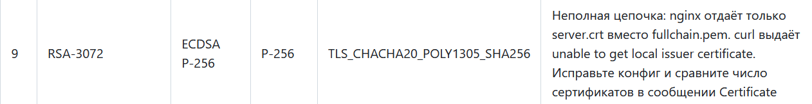
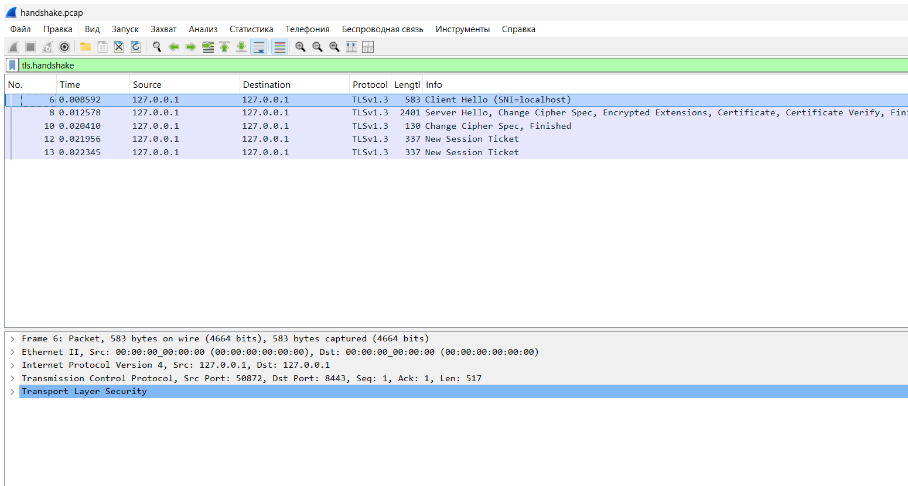

## Лабораторная работа №4

Вариант 9

Выполнил: Степанюк Артём Сергеевич


## Выпуск сертификатов

### Корневой CA

```bash
openssl genpkey -algorithm RSA -pkeyopt rsa_keygen_bits:3072 -out root/root.key
chmod 600 root/root.key

openssl req -new -x509 -key root/root.key -sha256 -days 3650 \
  -subj '/C=BY/O=Lab PKI/CN=Lab Root CA' \
  -addext 'basicConstraints=critical,CA:TRUE,pathlen:1' \
  -addext 'keyUsage=critical,keyCertSign,cRLSign' \
  -addext 'subjectKeyIdentifier=hash' \
  -out root/root.crt
```

### Промежуточный CA

```ini
# inter/inter.ext
basicConstraints=critical,CA:TRUE,pathlen:0
keyUsage=critical,keyCertSign,cRLSign
subjectKeyIdentifier=hash
authorityKeyIdentifier=keyid:always
```

```bash
openssl genpkey -algorithm RSA -pkeyopt rsa_keygen_bits:3072 -out inter/inter.key
chmod 600 inter/inter.key

openssl req -new -key inter/inter.key \
  -subj '/C=BY/O=Lab PKI/CN=Lab Intermediate CA' \
  -out inter/inter.csr

openssl x509 -req -in inter/inter.csr \
  -CA root/root.crt -CAkey root/root.key -CAcreateserial \
  -sha256 -days 1825 -extfile inter/inter.ext \
  -out inter/inter.crt
```

Результат:

```text
Certificate request self-signature ok
subject=C = BY, O = Lab PKI, CN = Lab Intermediate CA
```

### Серверный сертификат

```ini
# server/server.ext
basicConstraints=critical,CA:FALSE
keyUsage=critical,digitalSignature
extendedKeyUsage=serverAuth
subjectKeyIdentifier=hash
authorityKeyIdentifier=keyid:always
subjectAltName=DNS:localhost,IP:127.0.0.1
```

```bash
openssl genpkey -algorithm EC -pkeyopt ec_paramgen_curve:P-256 -out server/server.key
chmod 600 server/server.key

openssl req -new -key server/server.key \
  -subj '/C=BY/O=Lab PKI/CN=localhost' \
  -out server/server.csr

openssl ca -config inter/ca.cnf -batch \
  -in server/server.csr \
  -extfile server/server.ext \
  -notext -out server/server.crt
```

Результат:

```text
Certificate is to be certified until Nov 18 11:20:35 2027 GMT (365 days)
Write out database with 1 new entries
Database updated
```

В `inter/ca.cnf` заданы `default_days = 365`, `default_crl_days = 30`, `unique_subject = no`, `copy_extensions = none` и политика `policy_any` с обязательным commonName.

### Расширения сертификатов

- root.crt: Basic Constraints `CA:TRUE, pathlen:1`; Key Usage `Certificate Sign, CRL Sign`.
- inter.crt: Basic Constraints `CA:TRUE, pathlen:0`; Key Usage `Certificate Sign, CRL Sign`.
- server.crt: Basic Constraints `CA:FALSE`; Key Usage `Digital Signature`; EKU `TLS Web Server Authentication`; SAN `DNS:localhost, IP Address:127.0.0.1`.
- SKI корня: `F1:F0:89:B3:5B:81:A4:77:D3:B0:80:7C:95:44:CF:77:6A:B3:77:AC`.
- SKI промежуточного: `17:B2:8F:71:04:B6:E6:2D:0C:51:3C:F5:68:1D:96:9C:2D:A7:6A:4E`.
- SKI сервера: `58:8F:51:E1:6A:BC:D0:47:12:FE:83:A8:01:81:D3:0E:41:30:F2:C2`.
- AKI сервера совпадает с SKI промежуточного.

## Проверка цепочки

```bash
openssl verify -CAfile root/root.crt -untrusted inter/inter.crt server/server.crt
```

```text
server/server.crt: OK
```

Негативный тест без промежуточного сертификата:

```bash
openssl verify -CAfile root/root.crt server/server.crt
```

```text
CN = localhost
error 20 at 0 depth lookup: unable to get local issuer certificate
error server/server.crt: verification failed
```

## Настройка nginx

```nginx
server {
    listen 8443 ssl;
    server_name localhost;

    ssl_certificate     /home/lab/lab4/server/fullchain.pem;
    ssl_certificate_key /home/lab/lab4/server/server.key;

    ssl_protocols TLSv1.3;
    ssl_conf_command Ciphersuites TLS_CHACHA20_POLY1305_SHA256;
    ssl_ecdh_curve P-256;

    ssl_session_tickets on;

    location / { return 200 'tls13 ok'; }
}
```

```bash
nginx -t
```

```text
nginx: the configuration file /etc/nginx/nginx.conf syntax is ok
nginx: configuration file /etc/nginx/nginx.conf test is successful
```

`fullchain.pem` собран как `server.crt` плюс `inter.crt`, поэтому клиент получает промежуточный сертификат и может построить цепочку до корня.

## Проверка HTTPS и негативные тесты

Успешное подключение:

```bash
curl -v --cacert root/root.crt https://localhost:8443/
```

```text
* SSL connection using TLSv1.3 / TLS_CHACHA20_POLY1305_SHA256 / prime256v1 / id-ecPublicKey
*  subject: CN=localhost
*  subjectAltName: host "localhost" matched cert's "localhost"
*  issuer: C=BY; O=Lab PKI; CN=Lab Intermediate CA
*  SSL certificate verify ok.
< HTTP/1.1 200 OK
tls13 ok
```

Негативные тесты:

- Без доверенного корня: `curl https://localhost:8443/`. Результат: `curl: (60) unable to get local issuer certificate`, exit 60.
- Имя вне SAN: `curl --cacert root/root.crt https://127.0.0.2:8443/`. Результат: `curl: (60) no alternative certificate subject name matches target host name '127.0.0.2'`, exit 60.
- Чужой корень: `curl --cacert /tmp/other.crt https://localhost:8443/`. Результат: `curl: (60) unable to get local issuer certificate`, exit 60.
- TLS 1.2: `( sleep 1 ) | openssl s_client -connect localhost:8443 -tls1_2 -CAfile root/root.crt`. Результат: `tlsv1 alert protocol version`, SSL alert number 70, exit 1.
- Просроченный сертификат: `openssl verify -attime 1829560839 -CAfile root/root.crt -untrusted inter/inter.crt server/server.crt`. Результат: `error 10 at 0 depth lookup: certificate has expired`, exit 2.
- Отозванный сертификат: `openssl verify -crl_check -CRLfile inter/crl.pem -CAfile root/root.crt -untrusted inter/inter.crt server/revoked.crt`. Результат: `error 23 at 0 depth lookup: certificate revoked`, exit 2.

Для проверки отзыва выпущен отдельный сертификат `revoked.local` с серийным номером 1001. CRL подписан промежуточным CA и содержит этот номер. Серверный сертификат с той же CRL остаётся действительным: `server/server.crt: OK`.

## Захват TLS 1.3 и анализ

```bash
sudo tcpdump -i lo -w ~/lab4/client/handshake.pcap 'tcp port 8443'

SSLKEYLOGFILE=$HOME/lab4/client/keys.log \
  curl --curves P-256 -sS --cacert root/root.crt https://localhost:8443/

cut -d' ' -f1 keys.log | sort -u
```

```text
CLIENT_HANDSHAKE_TRAFFIC_SECRET
CLIENT_TRAFFIC_SECRET_0
EXPORTER_SECRET
SERVER_HANDSHAKE_TRAFFIC_SECRET
SERVER_TRAFFIC_SECRET_0
```

Опция `--curves P-256` задаёт клиенту группу из варианта. Без неё curl предлагает X25519, а nginx с единственной группой P-256 отвечает HelloRetryRequest.

Без журнала ключей:

```bash
tshark -r handshake.pcap -Y tls -T fields \
  -e frame.number -e tls.record.content_type -e tls.handshake.type
```

```text
6    22    1
8    22,20 2
10   20
11
12
13
14
16
```

Видны только ClientHello и ServerHello. Остальные записи имеют content type 22 или 20 и не раскрывают сообщения рукопожатия.

С журналом ключей:

```bash
tshark -r handshake.pcap -o tls.keylog_file:keys.log \
  -Y tls.handshake -T fields -e frame.number -e tls.handshake.type
```

```text
6    1
8    2,8,11,15,20
10   20
12   4
13   4
```

После загрузки `keys.log` видны ServerHello, EncryptedExtensions, Certificate, CertificateVerify, Finished и NewSessionTicket.

Параметры рукопожатия:

- Шифровой набор: `0x1303`, TLS_CHACHA20_POLY1305_SHA256.
- Группа key_share: `23`, P-256.
- SNI в ClientHello: `localhost`.
- SAN в сертификате: `dNSName: localhost`, `iPAddress: 127.0.0.1`.
- Подпись CertificateVerify: `0x0403`, ecdsa_secp256r1_sha256.



Без ключей видны только ClientHello и ServerHello. Журнал ключей добавляет расшифровку сертификата, подписи CertificateVerify и Finished. Сервер nginx журнал не пишет, его создаёт клиент curl.

## Задача варианта 9: неполная цепочка

В конфигурации nginx директива `ssl_certificate` была временно переключена с `fullchain.pem` на `server.crt`, поэтому сервер перестал отправлять промежуточный сертификат.

```nginx
ssl_certificate /home/lab/lab4/server/server.crt;
```

```bash
curl -v --curves P-256 --cacert root/root.crt https://localhost:8443/
```

```text
* TLSv1.3 (IN), TLS handshake, Certificate (11): { [806 bytes data] }
* TLSv1.3 (OUT), TLS alert, unknown CA (560)
* SSL certificate problem: unable to get local issuer certificate
curl: (60) SSL certificate problem: unable to get local issuer certificate
```

Количество сертификатов определялось по полю `tls.handshake.certificate_length`:

```bash
tshark -r handshake.pcap -o tls.keylog_file:keys.log \
  -Y 'tls.handshake.type == 11' -T fields -e tls.handshake.certificate_length
```

```text
793,1130
```

```bash
tshark -r incomplete.pcap -o tls.keylog_file:keys_incomplete.log \
  -Y 'tls.handshake.type == 11' -T fields -e tls.handshake.certificate_length
```

```text
793
```

Результат сравнения:

- fullchain.pem: длины 793 и 1130, два сертификата, HTTP 200 и `tls13 ok`.
- server.crt: длина 793, один сертификат, exit 60 и `unable to get local issuer certificate`.

В неполной цепочке сервер отдаёт только листовой сертификат. Клиент не может найти издателя листа, поэтому цепочка до корня не строится. После возврата `fullchain.pem` запрос снова возвращает HTTP 200 и `tls13 ok`.
